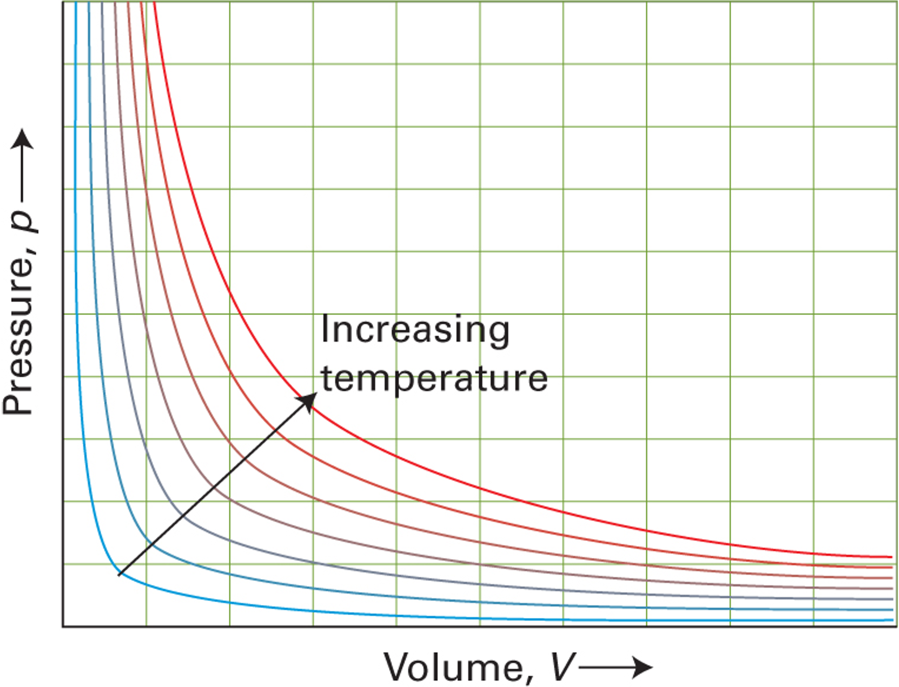
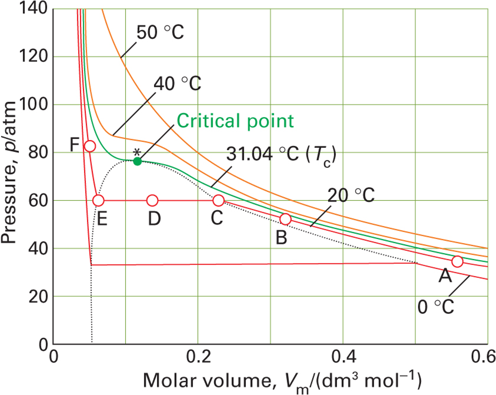
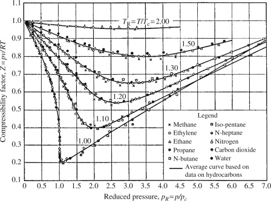
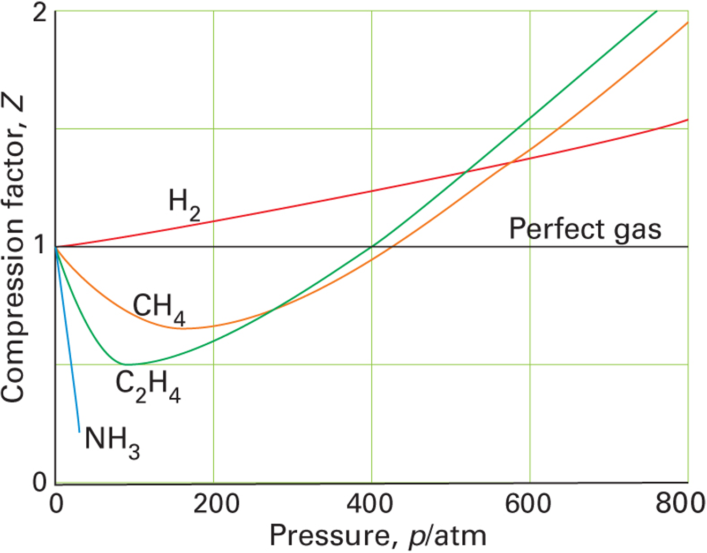

# Energie en de eerste hoofdwet van de thermodynamica {#sec-ch-energie}

## Waarom thermodynamica?

Een procesingenieur krijgt de opdracht een nieuwe gascompressor te dimensioneren voor een chemische installatie. Het gas moet worden samengeperst alvorens het naar een reactor wordt gestuurd. Al tijdens de eerste simulaties blijkt dat de temperatuur van het gas aanzienlijk stijgt tijdens de compressie. Deze temperatuurstijging heeft belangrijke gevolgen. Hogere temperaturen kunnen de levensduur van de compressor verkorten, stellen hogere eisen aan de gebruikte materialen en verhogen het energieverbruik van de volledige installatie. Om deze redenen worden industriële compressoren vaak opgebouwd uit meerdere compressietrappen die onderling worden gekoeld.

Voor een beginnende ingenieur roept dit onmiddellijk een aantal fundamentele vragen op. Waarom stijgt de temperatuur wanneer een gas wordt samengeperst? Waar komt de hiervoor benodigde energie vandaan? Hoeveel arbeid is nodig om een gas tot een bepaalde druk te comprimeren? Waarom verlaagt tussentijdse koeling het benodigde compressorvermogen? Wanneer kan een gas nog als ideaal worden beschouwd en wanneer zijn uitgebreidere toestandsvergelijkingen noodzakelijk?

Hoewel deze vragen op het eerste gezicht zeer uiteenlopend lijken, kunnen zij allemaal worden beantwoord met dezelfde fysische principes. Deze principes vormen het studiegebied van de thermodynamica.

De thermodynamica beschrijft hoe energie wordt opgeslagen, uitgewisseld en omgezet tijdens fysische en chemische processen. Zij vormt daardoor één van de fundamentele pijlers van de chemische technologie. Zonder thermodynamica is het onmogelijk om warmtewisselaars, destillatiekolommen, reactoren, compressoren, turbines of koelinstallaties op een rationele manier te ontwerpen.

Het bijzondere aan de thermodynamica is dat zij geen kennis vereist van de beweging van individuele moleculen. Een industrieel proces bevat doorgaans een onvoorstelbaar groot aantal moleculen, waardoor een volledige beschrijving van elke afzonderlijke botsing onmogelijk is. De thermodynamica kiest daarom voor een andere benadering: in plaats van het gedrag van individuele moleculen te bestuderen, beschrijft zij het systeem aan de hand van een beperkt aantal macroscopische grootheden, zoals de temperatuur, de druk en het volume. Ondanks deze sterke vereenvoudiging laat de thermodynamica toe het gedrag van zeer complexe processen met een opmerkelijk hoge nauwkeurigheid te voorspellen.

In dit hoofdstuk worden de fundamentele concepten van de klassieke thermodynamica stap voor stap opgebouwd. Daarbij vertrekken we steeds vanuit een fysisch of industrieel probleem, waarna de noodzakelijke theorie wordt ontwikkeld. De nadruk ligt niet uitsluitend op het afleiden van vergelijkingen, maar vooral op het begrijpen van hun fysische betekenis en hun toepassing binnen de chemische en biochemische procestechnologie.

## Het thermodynamisch systeem

Elke thermodynamische analyse begint met het afbakenen van het deel van de werkelijkheid dat zal worden bestudeerd. Dit deel wordt het *thermodynamisch systeem* genoemd. Alles buiten het systeem behoort tot de *omgeving*. De grens die beide van elkaar scheidt wordt de *systeemgrens* genoemd.

Deze afbakening lijkt op het eerste gezicht een eenvoudige stap, maar is in werkelijkheid één van de belangrijkste keuzes die een ingenieur maakt. De energiebalansen, massabalansen en uiteindelijk ook de ontwerpvergelijkingen zijn immers volledig afhankelijk van de gekozen systeemgrens.

::: {.callout-note}
## Toepassing: Compressor

Beschouw de compressor uit de inleiding. Twee ingenieurs kunnen hetzelfde fysische proces analyseren, maar toch verschillende energiebalansen opstellen omdat zij een andere systeemgrens kiezen. Wanneer uitsluitend de compressor wordt beschouwd, treden verschillende energiestromen over de systeemgrens: het gas stroomt binnen en verlaat de compressor opnieuw onder een hogere druk, terwijl mechanische arbeid wordt geleverd via een aandrijfas en warmte kan worden afgegeven. Wordt daarentegen de elektromotor samen met de compressor als één systeem beschouwd, dan verdwijnt de mechanische arbeid uit de energiebalans en wordt deze vervangen door een elektrische vermogensstroom. Beide beschrijvingen zijn correct, mits de systeemgrens consequent wordt toegepast.
:::

Afhankelijk van de interactie tussen het systeem en de omgeving onderscheidt men twee fundamentele types thermodynamische systemen.

### Gesloten systemen

Een *gesloten systeem* laat geen massa door de systeemgrens, maar energie kan de systeemgrens wel overschrijden onder de vorm van warmte of arbeid. Een klassieke zuiger-cilinder-opstelling vormt hiervan het bekendste voorbeeld. De hoeveelheid gas in de cilinder blijft constant, terwijl warmte aan het systeem kan worden toegevoerd en de zuiger arbeid kan verrichten op de omgeving.

Vrijwel alle fundamentele afleidingen in de klassieke thermodynamica worden eerst uitgevoerd voor gesloten systemen. Hierdoor kunnen de basiswetten worden ontwikkeld zonder dat massatransport in rekening moet worden gebracht.

### Open systemen

In de meeste industriële installaties stroomt materie voortdurend het systeem binnen en opnieuw naar buiten. Dergelijke systemen worden *open systemen* genoemd. Compressoren, pompen, turbines, warmtewisselaars, destillatiekolommen, reactoren en fermentoren behoren vrijwel zonder uitzondering tot deze categorie.

Bij open systemen wordt naast de energiebalans ook een massabalans opgesteld. Omdat de aangevoerde en afgevoerde stromen eveneens energie transporteren, zal in latere paragrafen blijken dat hiervoor een nieuwe energiegrootheid noodzakelijk is: de enthalpie.

::: {.callout-note}
## Toepassing: Destillatiekolom

Een destillatiekolom is een typisch voorbeeld van een open systeem. Het voedingsmengsel stroomt de kolom binnen, terwijl bovenaan een destillaatstroom en onderaan een bodemproduct worden afgevoerd. Daarnaast wordt warmte toegevoerd in de reboiler en onttrokken in de condensor. Het opstellen van de massa- en energiebalansen voor dergelijke installaties vormt de basis van het ontwerp van scheidingsprocessen.
:::

## Thermodynamisch evenwicht

Een systeem kan slechts eenduidig worden beschreven wanneer het zich in een toestand van thermodynamisch evenwicht bevindt. Beschouw een afgesloten recipiënt waarin zich een gas bevindt. Indien het gas pas werd samengeperst, zal de druk in verschillende delen van het vat aanvankelijk niet volledig uniform zijn. Na verloop van tijd verdwijnen deze lokale verschillen spontaan. Uiteindelijk wordt overal in het vat dezelfde druk en dezelfde temperatuur gemeten.

Een systeem bevindt zich slechts in volledig thermodynamisch evenwicht wanneer gelijktijdig aan drie voorwaarden wordt voldaan.

### Thermisch evenwicht

Wanneer twee systemen met een verschillende temperatuur met elkaar in contact worden gebracht, zal warmte spontaan van het warmste naar het koudste systeem stromen. Pas wanneer geen netto warmtestroom meer optreedt, spreekt men van thermisch evenwicht.

::: {.callout-warning}
## Definitie: Nulde hoofdwet van de thermodynamica

Indien systeem $A$ in thermisch evenwicht is met systeem $C$ en systeem $B$ eveneens in thermisch evenwicht is met systeem $C$, dan bevinden ook systeem $A$ en systeem $B$ zich onderling in thermisch evenwicht.
:::

Hoewel deze uitspraak vanzelfsprekend lijkt, vormt zij de fundamentele basis voor de definitie van temperatuur. Het is namelijk mogelijk door deze definitie om de temperatuur van een object te bepalen door dit te vergelijken met een ander object.

### Mechanisch evenwicht

Beschouw een cilinder met een beweegbare zuiger. Wanneer de gasdruk groter is dan de uitwendige druk, zal de zuiger spontaan naar buiten bewegen. De beweging stopt pas wanneer beide drukken identiek zijn: $$p = p_{\text{ext}}$$ Op dat ogenblik is de resulterende kracht op de zuiger nul ($\Delta p=0$) en bevindt het systeem zich in mechanisch evenwicht.

### Chemisch evenwicht

Beschouw de synthese van ammoniak uit stikstof en waterstof: $$\ce{N2 + 3 H2 <=> 2NH3}.$$ Wanneer de reactie wordt gestart met uitsluitend stikstof en waterstof, zal de vorming van ammoniak spontaan verlopen. Naarmate de concentratie ammoniak stijgt, wordt ook de omgekeerde reactie belangrijker. Uiteindelijk wordt een toestand bereikt waarbij beide reacties even snel verlopen. Hoewel de reactie op moleculaire schaal blijft plaatsvinden, veranderen de macroscopische concentraties niet langer. Men spreekt dan van een *dynamisch chemisch evenwicht*.

## Toestandsvariabelen

De toestand van een systeem wordt beschreven aan de hand van een beperkt aantal meetbare grootheden, de *toestandsvariabelen*: druk, temperatuur, volume en chemische samenstelling. Het gebruik van toestandsvariabelen vormt één van de grootste sterktes van de thermodynamica. Een industriële reactor van $100~\mathrm{m^3}$ bevat gemakkelijk meer dan $10^{30}$ moleculen. Toch kan de toestand van deze reactor vaak volledig worden beschreven met slechts enkele macroscopische grootheden.

### Intensieve en extensieve grootheden

Een *extensieve grootheid* is evenredig met de hoeveelheid materie in het systeem. Wanneer twee identieke systemen worden samengevoegd, verdubbelt de waarde van een extensieve grootheid. Voorbeelden: de massa $m$, het volume $V$, het aantal mol $n$, de interne energie $U$, de enthalpie $H$, de entropie $S$.

Een *intensieve grootheid* is onafhankelijk van de grootte van het systeem. Voorbeelden: de temperatuur $T$, de druk $p$, de dichtheid $\rho$, de concentratie.

::: {.callout-note}
## Toepassing: Warmtewisselaar

In een warmtewisselaar wordt warmte overgedragen van een warme naar een koude processtroom. De warmtestroom wordt gedreven door een temperatuurverschil, een intensieve grootheid. De hoeveelheid overgedragen warmte is daarentegen een extensieve grootheid en is afhankelijk van het massadebiet van beide stromen.
:::

### Toestandsfuncties en padfuncties

De interne energie blijkt uit experimenten uitsluitend af te hangen van de begin- en eindtoestand van het systeem: $$\Delta U = U_2 - U_1$$ De interne energie is dus een *toestandsfunctie*. Hetzelfde geldt voor de enthalpie, de entropie en de Gibbs-vrije energie.

Warmte en arbeid gedragen zich echter fundamenteel anders. Hun waarde hangt af van het gevolgde proces en niet uitsluitend van de begin- en eindtoestand. Warmte en arbeid zijn daarom *padfuncties*.

Om dit onderscheid ook mathematisch duidelijk te maken, wordt voor toestandsfuncties een exact differentiaal gebruikt, $\dd U$, terwijl voor warmte en arbeid een inexact differentiaal wordt geschreven, $\delta Q$ en $\delta W$.

Het onderscheid tussen deze twee begrippen kan eenvoudig voorgestekd worden door dit voorbeeld. Stel men maakt een rondrit door de bergen van een punt A op de berg naar punt B in het dal en vervolgens weer terug naar A. Daarbij kijken we naar twee meters in de auto: een luchtdrukmeter en de benzinemeter. Voor de luchtdrukmeter maakt het niet uit welke weg er gekozen wordt: bij het meten van de luchtdruk P in A voor en na het traject wordt dezelfde waarde gevonden, en in B een andere, hogere waarde (weersveranderingen daargelaten). Voor de benzinemeter van de auto is dat echter een ander verhaal: die zal voor de rit in A een andere waarde aangeven dan na de rit in A. De luchtdruk is dus een toestandsfunctie, en de brandstofstand niet. De luchtdruk is alleen een functie van de toestand, maar de brandstofstand is daarnaast ook een functie van de afgelegde weg.

### Temperatuur en druk

Temperatuur en druk zijn de twee belangrijkste intensieve toestandsvariabelen. De temperatuur wordt gedefinieerd via de nulde hoofdwet en gemeten met een thermometer. De druk wordt gedefinieerd als kracht per oppervlakte-eenheid en gemeten met een manometer. Beide grootheden zijn intensief: zij beschrijven de lokale toestand van het systeem en veranderen niet wanneer de systeemgrootte wordt verdubbeld.

## Toestandsvergelijkingen

De verschillende toestandsvariabelen zijn niet onafhankelijk van elkaar. Zij worden onderling verbonden door fysische relaties die *toestandsvergelijkingen* worden genoemd. De eenvoudigste en bekendste hiervan is de ideale gaswet.

### De ideale gaswet

Voor een verdund gas blijkt de relatie tussen druk, volume, temperatuur en hoeveelheid stof bijzonder eenvoudig: $$pV = nRT,$$ waarin $R$ de universele gasconstante is, $R = 8.314\,\mathrm{J}\,\mathrm{mol}^{-1}\,\mathrm{K}^{-1}$. De waarde van de gasconstante kan veranderen als er andere eenheden dan de SI-eenheden gebruikt worden in de ideale gaswet. Het is belangrijk om dit steeds te verifiëren. De ideale gaswet is geen afzonderlijk model naast de reële gasmodellen, maar vormt de limiet waartoe alle toestandsvergelijkingen moeten convergeren. Met andere woorden, de ideale gaswet is *een limiet-wet*. Alle gassen waarbij $p \rightarrow 0$ voldoen aan de ideale gaswet.

### Afwijkingen van ideaal gedrag: experimentele observaties

De ideale gaswet werd oorspronkelijk afgeleid onder twee aannames: (1) moleculen bezitten geen eigen volume, en (2) er bestaan geen intermoleculaire krachten tussen de gasmoleculen onderling. Voor verdunde gassen bij matige druk werken deze aannames uitstekend. Reeds in de negentiende eeuw evenwel stelden fysische chemici vast dat systematische afwijkingen optreden naarmate men de condities extremalisatie.

#### Boyle-afwijkingen

De eenvoudigste test van de ideale gaswet is de wet van Boyle: bij constante temperatuur moet $pV$ constant zijn (zie Figuur [-@fig-boyle]), onafhankelijk van de druk. Regnault (1845) en later Amagat (1870) voerden nauwkeurige metingen uit en vonden dat $pV$ voor reële gazen niet constant is, maar systematisch afwijkt naarmate de druk toeneemt.

-   Voor stikstof bij $0{}^{\circ}\mathrm{C}$ en drukken tot $10\,\mathrm{bar}$ bedraagt de afwijking minder dan $0.5\%$: de ideale gaswet is een uitstekende benadering. Bij $100\,\mathrm{bar}$ bedraagt de afwijking reeds $5\%$; bij $500\,\mathrm{bar}$ meer dan $30\%$.

-   Voor $\ce{CO2}$ bij $40{}^{\circ}\mathrm{C}$ en $100\,\mathrm{bar}$ bedraagt de afwijking meer dan $20\%$, en bij lagere temperaturen kan condensatie optreden, hetgeen de ideale gaswet volledig ongeldig maakt.

{#fig-boyle width="50%"}

#### Joule--Thomson-effect

Een tweede experimentele observatie is het Joule--Thomson-effect: wanneer een gas door een poruese wand expandeert van hoge naar lage druk zonder warmte-uitwisseling, verandert de temperatuur. Voor een ideaal gas ($\partial U/\partial V|_T = 0$) zou de temperatuur constant blijven. Experimenteel evenwel koelen de meeste gassen af bij expansie bij kamertemperatuur (positieve Joule--Thomson-coëfficiënt), hetgeen aantoont dat de interne energie van een reëel gas afhangt van het volume --- een direct gevolg van intermoleculaire krachten.

#### Condensatie

De meest in het oog springende afwijking is de condensatie zelf (zie Figuur [-@fig-afwijkingboyle]). De ideale gaswet voorspelt dat een gas bij willekeurig hoge druk een arbitrair klein volume kan bereiken. In werkelijkheid evenwel condenseert elk gas bij voldoende hoge druk en voldoende lage temperatuur tot een vloeistof met een eindig, nagenoeg constant volume. De ideale gaswet heeft geen verklaring voor het bestaan van een vloeistoffase, laat staan voor de kritische temperatuur boven dewelke vloeibaarheid onmogelijk is. Een gas boven de kritische temperatuur ($T_c$) zal bij compressie nooit condenseren. Voor $\ce{CO2}$ bedraagt de kritische temperatuur $31.04{}^{\circ}\mathrm{C}$.

{#fig-afwijkingboyle width="50%"}

### De compressibiliteitsfactor als kwantitatieve maat

Om de afwijking systematisch te kwantificeren, wordt de *compressibiliteitsfactor* $Z$ ingevoerd: $$\boxed{\;Z = \frac{V_{m,werk}}{V_{m,ideaal}}=\frac{pV_{m,werk}}{RT}\;}$$ Voor een ideaal gas geldt $Z = 1$. Afwijkingen van $Z = 1$ wijzen op niet-ideaal gedrag. De waarde van $Z$ en zijn afhankelijkheid van druk en temperatuur bevatten informatie over de aard van de intermoleculaire interacties:

-   $Z < 1$: de werkelijke druk is lager dan door de ideale gaswet voorspeld, of equivalent het werkelijke molaire volume is kleiner dan verwacht. Dit wijst op *aantrekkende* intermoleculaire krachten die de moleculen dichter bij elkaar brengen. Typisch bij matige drukken en lage temperaturen.

-   $Z > 1$: de werkelijke druk is hoger dan verwacht, of het werkelijke molaire volume is groter. Dit wijst op *afstotende* krachten; het eindige moleculaire volume wordt bepalend. Typisch bij zeer hoge drukken.

-   $Z \to 1$ naarmate $p \to 0$ of $T \to \infty$: in de limiet van verdunde of zeer hete gassen verdwijnen alle intermoleculaire effecten. De ideale gaswet is in deze limiet gevallen steeds geldig.

Tabel [↗](#tbl-z) geeft $Z$ voor koolstofdioxide bij verschillende condities. We merken dat bij lage druk $Z \approx 1$; bij matige druk domineren aantrekkingskrachten ($Z < 1$); bij zeer hoge druk domineert het eindige moleculaire volume ($Z > 1$).

[]{#tbl-z}

| $T$ ($\mathrm{K}$) | $p$ ($\mathrm{bar}$) | $V_m$ ($\mathrm{L}\,\mathrm{mol}^{-1}$) | $Z$  |
|:------------------:|:--------------------:|:---------------------------------------:|:----:|
|        350         |          1           |                  24.5                   | 1.00 |
|        350         |          50          |                  0.41                   | 0.70 |
|        350         |         200          |                  0.15                   | 1.03 |
|        350         |         1000         |                  0.045                  | 2.16 |

: Compressibiliteitsfactor $Z$ voor $\ce{CO_2}$ bij verschillende condities.

Een opmerkelijke empirische observatie is dat, wanneer $Z$ wordt uitgezet tegen de *gereduceerde druk* $p_r = p/p_c$ voor verschillende gassen bij dezelfde *gereduceerde temperatuur* $T_r = T/T_c$, alle gassen nagenoeg op dezelfde curve vallen (zie Figuur [-@fig-compchart]). Dit is de *wet van corresponderende toestanden*. De compressibiliteitsfactor blijkt dus in eerste benadering een universele functie te zijn van $T_r$ en $p_r$, onafhankelijk van de chemische identiteit van het gas. Deze wet vormt de basis van de zogenaamde algemene compressibiliteitskaarten die door ingenieurs worden gebruikt wanneer geen specifieke toestandsvergelijking beschikbaar is.

{#fig-compchart width="80%"}

Twee fundamentele effecten liggen aan de basis van alle geobserveerde afwijkingen:

1.  **Eindig moleculair volume**: moleculen bezitten een eigen afmeting (typisch $0.3\,\mathrm{nm}$ diameter). Het volume dat beschikbaar is voor translatiebeweging is dus kleiner dan het geometrische volume van de recipiënt. Naarmate de druk stijgt, wordt dit effect relatief belangrijker.

2.  **Intermoleculaire krachten**: op gemiddelde afstand oefenen moleculen zwakke aantrekkingskrachten op elkaar (Van der Waals; zie Hoofdstuk [-@sec-ch-intermoleculair]). Deze krachten persen de moleculen samen, zodat de werkelijke druk lager is dan door de ideale gaswet wordt voorspeld. Op zeer korte afstand, wanneer elektronenwolken overlappen, treedt sterke afstoting op.

De balans tussen beide effecten verklaart de niet-monotone afhankelijkheid van $Z$ van de druk (zie Figuur [-@fig-z]): bij lage druk domineren de aantrekkingskrachten ($Z < 1$), bij hoge druk domineert het eindige volume ($Z > 1$). Tussen beide door is er een zogenaamde *Boyle-temperatuur* waarvoor $Z = 1$ over een breed drukbereik.

{#fig-z width="50%"}

### De vergelijking van Van der Waals: een fysische afleiding

De eerste succesvolle poging om de ideale gaswet te corrigeren voor beide effecten werd in 1873 voorgesteld door Johannes Diderik van der Waals. Zijn vergelijking markeert het begin van de moderne thermodynamica van reële fluïda, en leverde hem in 1910 de Nobelprijs voor fysica op. In plaats van een empirische correlatie te zoeken, vertrok Van der Waals van de fysische oorsprong van de afwijkingen en leidde hij daaruit analytisch een gecorrigeerde toestandsvergelijking af. We bouwen deze afleiding hier stapsgewijs op, telkens vertrekkend van een fysisch idee.

#### Stap 1: de volumecorrectie - het uitgesloten volume

Beschouw $n$ mol gas in een recipiënt met volume $V$. In de ideale gaswet wordt aangenomen dat het volledige volume beschikbaar is voor de beweging van de moleculen. Voor reële moleculen is dit niet correct: een molecule bezit een eigen afmeting, en de zwaartepunten van twee moleculen kunnen niet willekeurig dicht naderen. Beschouw twee harde bollen met straal $r$. Hun zwaartepunten kunnen niet dichter naderen dan $2r$, zodat rond ieder molecule een *uitgesloten bol* met straal $2r$ (en volume $\tfrac{4}{3}\pi(2r)^3 = 8 \cdot \tfrac{4}{3}\pi r^3$) ontstaat die niet door het zwaartepunt van een andere molecule kan worden bezet. Omdat het uitgesloten volume voor een koppel moleculen echter gedeeld is door beide, bedraagt de effectief uitgesloten volume per molecule $\tfrac{1}{2} \cdot 8 \cdot \tfrac{4}{3}\pi r^3 = 4 \cdot \tfrac{4}{3}\pi r^3$.

Voor $N_A$ moleculen per mol bedraagt het totaal uitgesloten volume per mol: $$b = 4 N_A \cdot \tfrac{4}{3}\pi r^3$$ Dit is het *co-volume* $b$. Belangrijke observatie: $b$ is *viermaal* het eigenlijke moleculaire volume. Het vrij beschikbare volume voor translatiebeweging van de gasmoleculen is: $$V_{\text{vrij}} = V - nb.$$ De gecorrigeerde gaswet, alleen met de volumecorrectie, wordt hierdoor: $$p(V - nb) = nRT.$$

#### Stap 2: de drukcorrectie - intermoleculaire aantrekkingskrachten

De volumecorrectie alleen volstaat niet. Een tweede fundamenteel verschil met het ideale gasmodel is dat reële moleculen aantrekkingskrachten op elkaar uitoefenen.

Om het effect hiervan te begrijpen, bekijken we een molecule die zich vlak voor de wand van een recipiënt bevindt. Volgens de kinetische gastheorie ontstaat de gasdruk doordat moleculen tegen de wand botsen en daarbij impuls overdragen. Bij een ideaal gas wordt aangenomen dat de molecule zich tussen twee botsingen volledig vrij beweegt. De snelheid waarmee zij de wand bereikt, wordt uitsluitend bepaald door haar kinetische energie. Bij een reëel gas is dit niet langer het geval. De molecule wordt, terwijl zij naar de wand beweegt, aangetrokken door de omliggende moleculen die zich in het binnenste van het vat bevinden. Deze aantrekkingskracht werkt tegengesteld aan haar bewegingsrichting, waardoor de molecule de wand met een iets kleinere snelheid bereikt dan in het ideale geval. Ook onmiddellijk na de botsing blijft deze aantrekkingskracht werkzaam en wordt de molecule opnieuw naar het binnenste van het vat getrokken. Hierdoor is de impulsverandering tijdens de botsing kleiner dan voor een ideaal gas. Omdat de gasdruk rechtstreeks voortkomt uit de totale impulsoverdracht aan de wand, oefent een reëel gas bij dezelfde temperatuur en hetzelfde volume een lagere druk uit dan een ideaal gas.

Van der Waals stelde daarom voor om niet de werkelijk gemeten druk te gebruiken, maar de druk die het gas zou uitoefenen indien de intermoleculaire aantrekkingskrachten afwezig waren. Deze fictieve ideale druk kan worden geschreven als

$$p_{\mathrm{ideaal}}
=
p_{\mathrm{werkelijk}}
+
p_{\mathrm{correctie}}.$$

De drukcorrectie stelt dus precies het drukverlies voor dat veroorzaakt wordt door de aantrekkingskrachten tussen de moleculen. Hoe sterker de aantrekkingskrachten tussen de moleculen en hoe meer moleculen zich dicht bij elkaar bevinden, hoe groter de drukverlaging zal zijn. De sterkte van het effect hangt dus af van het aantal moleculaire interacties in het gas. Het aantal moleculen per volume-eenheid is evenredig met $\dfrac{n}{V}$. De kans dat een willekeurige molecule zich in de nabijheid van een tweede molecule bevindt, is eveneens evenredig met deze dichtheid. Het totale aantal onderlinge interacties is daarom evenredig met het product van beide kansen en dus met

$$\left(\frac{n}{V}\right)^2$$

Met andere woorden: wanneer de dichtheid van het gas verdubbelt, verdubbelt niet alleen het aantal moleculen, maar neemt ook het aantal mogelijke onderlinge interacties ongeveer viermaal toe. Daarom groeit het effect van de aantrekkingskrachten met het kwadraat van de molaire dichtheid.

Van der Waals stelde daarom de drukcorrectie voor als

$$p_{\mathrm{correctie}}
=
a\left(\frac{n}{V}\right)^2,$$

of

$$p_{\mathrm{correctie}}
=
a\frac{n^2}{V^2}$$

waarin de stofconstante $a$ een maat is voor de sterkte van de intermoleculaire aantrekkingskrachten. Gassen waarvan de moleculen elkaar sterk aantrekken, zoals $\ce{CO2}$ of $\ce{NH3}$, bezitten een grote waarde van $a$, terwijl zwak interagerende gassen zoals helium of waterstof een veel kleinere waarde hebben.

#### Stap 3: combinatie van beide correcties

Door beide correcties gelijktijdig toe te passen, vervangen we in de ideale gaswet $p \to p + a n^2/V^2$ en $V \to V - nb$. Dit levert: $$\boxed{\;\left(p + \frac{a n^2}{V^2}\right)(V - nb) = nRT\;}$$ of, uitgedrukt per mol ($V_m = V/n$): $$\boxed{\;\left(p + \frac{a}{V_m^2}\right)(V_m - b) = RT\;}$$

::: {.callout-tip}
## Voorbeeld: Vergelijking van het gedrag van $\ce{CO2}$ en He

Voor $\ce{CO2}$ gelden de Van der Waalsparameters $$a_{\ce{CO2}} = 0.364\,\mathrm{Pa}\,\mathrm{m}^{6}\,\mathrm{mol}^{-2}$$ en $$b_{\ce{CO2}} = 4.27\times10^{-5}\,\mathrm{m}^{3}\,\mathrm{mol}^{-1}.$$

Voor helium gelden $$a_{\ce{He}} = 0.0035\,\mathrm{Pa}\,\mathrm{m}^{6}\,\mathrm{mol}^{-2}$$ en $$b_{\ce{He}} = 2.38\times10^{-5}\,\mathrm{m}^{3}\,\mathrm{mol}^{-1}.$$

We vergelijken beide gassen bij dezelfde temperatuur en hetzelfde molaire volume: $$T=300\,\mathrm{K} \qquad\text{en}\qquad V_m=1.00\times10^{-3}\,\mathrm{m}^{3}\,\mathrm{mol}^{-1}.$$

De molaire vorm van de Van der Waalsvergelijking kan omgevormd worden naar de druk

$$p = \frac{RT}{V_m-b} - \frac{a}{V_m^2}$$ {#eq-vdw-numeriek-co2-he}

De compressibiliteitsfactor wordt berekend uit

$$Z = \frac{pV_m}{RT}$$

Voor een ideaal gas bij dezelfde temperatuur en hetzelfde molaire volume geldt

$$\begin{aligned}
p_{\mathrm{ideaal}}
&= \frac{RT}{V_m} \
&= \frac{8.314\,\mathrm{J}\,\mathrm{mol}^{-1}\,\mathrm{K}^{-1} \cdot 300\,\mathrm{K}}{1.00\times10^{-3}\,\mathrm{m}^{3}\,\mathrm{mol}^{-1}} \
&= 2.49\times10^{6}\,\mathrm{Pa} = 2.49\,\mathrm{MPa}
\end{aligned}$$

Voor het ideale gas is per definitie $$Z_{\mathrm{ideaal}}=1$$

##### Koolstofdioxide

Voor $\ce{CO2}$ bedraagt de drukterm waarin het eigen volume van de moleculen wordt gecorrigeerd

$$\begin{aligned}
\frac{RT}{V_m-b}
&= \frac{8.314\,\mathrm{J}\,\mathrm{mol}^{-1}\,\mathrm{K}^{-1} \cdot 300\,\mathrm{K} }{ \left(1.00\times10^{-3}\,\mathrm{m}^{3}\,\mathrm{mol}^{-1} - 4.27\times10^{-5}\,\mathrm{m}^{3}\,\mathrm{mol}^{-1} \right) } \
&= 2.61\,\mathrm{MPa}.
\end{aligned}$$

Doordat het beschikbare volume kleiner is dan het totale molaire volume, verhoogt deze correctie de berekende druk ten opzichte van het ideale gas.

De aantrekkingscorrectie bedraagt

$$\begin{aligned}
\frac{a}{V_m^2}
&= \frac{0.364\,\mathrm{Pa}\,\mathrm{m}^{6}\,\mathrm{mol}^{-2} }{ \left( 1.00\times10^{-3}\,\mathrm{m}^{3}\,\mathrm{mol}^{-1} \right)^2 } \
&= 3.64\times10^{5}\,\mathrm{Pa} = 0.364\,\mathrm{MPa}.
\end{aligned}$$

De door de Van der Waalsvergelijking voorspelde druk is bijgevolg

$$\begin{aligned}
p_{\ce{CO2}}
&= 2.61\,\mathrm{MPa} - 0.364\,\mathrm{MPa} \
&= \boxed{2.24\,\mathrm{MPa}}
\end{aligned}$$

De compressibiliteitsfactor is

$$\begin{aligned}
Z_{\ce{CO2}}
&= \frac{ \left(2.24\times10^{6}\,\mathrm{Pa}\right) \left(1.00\times10^{-3}\,\mathrm{m}^{3}\,\mathrm{mol}^{-1}\right) }{ \left(8.314\,\mathrm{J}\,\mathrm{mol}^{-1}\,\mathrm{K}^{-1}\right) \left(300\,\mathrm{K}\right) } \
&= \boxed{0.899}
\end{aligned}$$

Omdat $Z<1$, overheerst bij deze toestand het effect van de intermoleculaire aantrekkingskrachten. $\ce{CO2}$ oefent daardoor een lagere druk uit dan een ideaal gas bij dezelfde temperatuur en hetzelfde molaire volume.

##### Helium

Voor helium bedraagt de volumecorrectieterm

$$\begin{aligned}
\frac{RT}{V_m-b}
&=
\frac{
8.314\,\mathrm{J}\,\mathrm{mol}^{-1}\,\mathrm{K}^{-1}
\cdot
300\,\mathrm{K}
}{
\left(
1.00\times10^{-3}\,\mathrm{m}^{3}\,\mathrm{mol}^{-1}
-
2.38\times10^{-5}\,\mathrm{m}^{3}\,\mathrm{mol}^{-1}
\right)
}
\
&=
2.56\,\mathrm{MPa}.
\end{aligned}$$

De aantrekkingscorrectie is veel kleiner dan voor $\ce{CO2}$:

$$\begin{aligned}
\frac{a}{V_m^2}
&=
\frac{
0.0035\,\mathrm{Pa}\,\mathrm{m}^{6}\,\mathrm{mol}^{-2}
}{
\left(
1.00\times10^{-3}\,\mathrm{m}^{3}\,\mathrm{mol}^{-1}
\right)^2
}
\
&=
3.50\times10^{3}\,\mathrm{Pa}
=
0.00350\,\mathrm{MPa}.
\end{aligned}$$

De door de Van der Waalsvergelijking voorspelde druk wordt dan

$$\begin{aligned}
p_{\ce{He}}
&=
2.56\,\mathrm{MPa}
-
0.00350\,\mathrm{MPa}
\
&=
\boxed{2.55\,\mathrm{MPa}}.
\end{aligned}$$

De compressibiliteitsfactor bedraagt

$$\begin{aligned}
Z_{\ce{He}}
&=
\frac{
\left(2.55\times10^{6}\,\mathrm{Pa}\right)
\left(1.00\times10^{-3}\,\mathrm{m}^{3}\,\mathrm{mol}^{-1}\right)
}{
\left(8.314\,\mathrm{J}\,\mathrm{mol}^{-1}\,\mathrm{K}^{-1}\right)
\left(300\,\mathrm{K}\right)
}
\
&=
\boxed{1.023}.
\end{aligned}$$

Voor helium is $Z>1$. De intermoleculaire aantrekkingskrachten zijn zo zwak dat de volumecorrectie overheerst. Het gas oefent daardoor een iets hogere druk uit dan een ideaal gas bij dezelfde temperatuur en hetzelfde molaire volume.

##### Vergelijking

De resultaten kunnen worden samengevat als

::: center
| Gas        | $p$ ($\mathrm{MPa}$) |  $Z$  | Overheersend effect  |
|:-----------|:--------------------:|:-----:|:---------------------|
| Ideaal gas |         2.49         | 1.000 | geen correcties      |
| $\ce{CO2}$ |         2.24         | 0.899 | aantrekkingskrachten |
| He         |         2.55         | 1.023 | uitgesloten volume   |
:::

Hoewel beide gassen zich bij dezelfde temperatuur en hetzelfde molaire volume bevinden, wijken zij in tegengestelde richting af van het ideale gasgedrag. Voor $\ce{CO2}$ veroorzaakt de grote waarde van $a$ een duidelijke drukverlaging. Voor helium is de aantrekkingscorrectie vrijwel verwaarloosbaar en overheerst de correctie voor het eindige moleculaire volume.
:::

Een van de grootste successen van de vergelijking van Van der Waals is dat zij kwalitatief het bestaan van een *kritiek punt* voorspelt. Op het kritieke punt is er geen onderscheid meer tussen vloeistof en gas; in het $p$-$V$-diagram is de kritieke isotherm het scheidpunt tussen isothermen met een lokaal minimum en maximum (waar condensatie optreedt) en monotone isothermen.

Wiskundig correspondt het kritieke punt met een *buigpunt* van de kritieke isotherm: $\partial p/\partial V|_{T_c} = 0$ en $\partial^2 p/\partial V^2|_{T_c} = 0$. Uit de Van der Waals-vergelijking per mol, herschreven als $p = RT/(V_m - b) - a/V_m^2$, volgt:
Eerste afgelede gelijk aan nul: $$\left.\frac{\partial p}{\partial V_m}\right|_{T_c} = -\frac{RT_c}{(V_{m,c} - b)^2} + \frac{2a}{V_{m,c}^3} = 0.$$

Tweede afgelede gelijk aan nul: $$\left.\frac{\partial^2 p}{\partial V_m^2}\right|_{T_c} = \frac{2RT_c}{(V_{m,c} - b)^3} - \frac{6a}{V_{m,c}^4} = 0.$$ Uit deze beide vergelijkingen, samen met de oorspronkelijke Van der Waals-vergelijking bij het kritieke punt, volgen drie relaties tussen $a$, $b$ en de kritieke parameters $T_c$, $p_c$, $V_{m,c}$. Na herschikking: $$\begin{aligned}
V_{m,c} &= 3b, \
T_c &= \frac{8a}{27Rb}, \
p_c &= \frac{a}{27b^2}.
\end{aligned}$$ Omgekeerd, wanneer $T_c$ en $p_c$ experimenteel bekend zijn, kunnen $a$ en $b$ worden berekend: $$\begin{aligned}
a &= \frac{27 R^2 T_c^2}{64 p_c}, \
b &= \frac{R T_c}{8 p_c}.
\end{aligned}$$

::: {.callout-tip}
## Voorbeeld: Afleiding van $a$ en $b$ voor $\mathrm{CO_2}$ uit kritieke parameters

Voor $\ce{CO2}$ gelden experimenteel $T_c = 304.1\,\mathrm{K}$ en $p_c = 73.8\,\mathrm{bar}$.

Met $R = 8.314\,\mathrm{J}\,\mathrm{mol}^{-1}\,\mathrm{K}^{-1}$ $$\begin{aligned}
a &= \frac{27(8.314\,\mathrm{J}\,\mathrm{mol}^{-1}\,\mathrm{K}^{-1})^2(304.1\,\mathrm{K})^2}{64(7.38\times10^{6}\,\mathrm{Pa})} \
  &= \frac{27 \cdot 69.07 \cdot 92472}{64 \cdot 7.38 \cdot 10^6}\;\mathrm{Pa}\,\mathrm{m}^{6}\,\mathrm{mol}^{-2} \
  &\approx 0.365\,\mathrm{Pa}\,\mathrm{m}^{6}\,\mathrm{mol}^{-2}
\end{aligned}$$ Dit is in uitstekende overeenstemming met de experimenteel bepaalde waarde $a = 0.364\,\mathrm{Pa}\,\mathrm{m}^{6}\,\mathrm{mol}^{-2}$.

De parameter $b$ volgt uit: $$\begin{aligned}
b &= \frac{(8.314\,\mathrm{J}\,\mathrm{mol}^{-1}\,\mathrm{K}^{-1})(304.1\,\mathrm{K})}{8(7.38\times10^{6}\,\mathrm{Pa})} \
&\approx 4.28\times10^{-5}\,\mathrm{m}^{3}\,\mathrm{mol}^{-1}
\end{aligned}$$ Dit is opnieuw in goede overeenstemming met de experimentele waarde.

De Van der Waals-vergelijking is dus geen empirische aanpassing, maar een fysisch afleidbare vergelijking waarvan de parameters meetbaar zijn uit het kritieke gedrag.
:::

De kritieke compressibiliteitsfactor is een directe voorspelling van de Van der Waals-theorie en volgt uit combinatie van $V_{m,c} = 3b$, $T_c = 8a/(27Rb)$ en $p_c = a/(27b^2)$: $$Z_c = \frac{p_c V_{m,c}}{R T_c} = \frac{(a/27b^2)(3b)}{R \cdot 8a/(27Rb)} = \frac{3}{8} = 0.375.$$ Volgens de Van der Waals-vergelijking is $Z_c$ dus een *universele constante*, onafhankelijk van de stof. Experimenteel evenwel bedragen $Z_c$-waarden:

::: center
|  Molecule  | $Z_c$ |
|:----------:|:-----:|
|     He     | 0.305 |
| $\ce{H2}$  | 0.306 |
| $\ce{N2}$  | 0.287 |
| $\ce{CO2}$ | 0.275 |
| $\ce{H2O}$ | 0.229 |
| $\ce{NH3}$ | 0.242 |
:::

De afwijkingen tonen aan dat, hoewel Van der Waals qualitatief correct is, de quantitatieve nauwkeurigheid beperkt is, vooral voor sterk polaire stoffen. Meer geavanceerde vergelijkingen (Peng--Robinson, Soave--Redlich--Kwong) leveren betere kwantitatieve voorspellingen, maar behouden dezelfde fundamentele fysische structuur.

De vergelijking van Van der Waals blijft een vereenvoudigd model. Enkele beperkingen:

-   De parameter $a$ wordt verondersteld onafhankelijk van temperatuur, hetgeen fysisch niet correct is (intermoleculaire krachten nemen af met temperatuur door de hogere kinetische energie).

-   De parameter $b$ veronderstelt harde, niet-comprimeerbare moleculen, hetgeen de werkelijkheid niet volgt.

-   De voorspelde $Z_c = 0.375$ wijkt systematisch af van experimentele waarden (typisch 0.23--0.31).

-   De vloeistofdichtheid wordt steevast onderschat.

Gedurende de twintigste eeuw werden daarom verschillende verbeteringen voorgesteld:

-   **Redlich--Kwong** (1949): introduceert temperatuursafhankelijkheid in de $a$-parameter via $a/\sqrt{T}$.

-   **Soave--Redlich--Kwong** (1972): verbeterd met een algemene temperatuursafhankelijkheid, nauwkeuriger voor vooral dampdrukken van zuivere componenten.

-   **Peng--Robinson** (1976): specifiek gericht op vloeistofdichtheden en VLE-berekeningen, algemeen gebruikt in processimulators.

Al deze vergelijkingen behoren tot de *familie der kubische toestandsvergelijkingen*; zij behouden de fundamentele structuur van Van der Waals (correcties voor co-volume en intermoleculaire krachten) maar verfijnen de wiskundige vorm van de correctietermen. Voor onderwijsdoeleinden evenals voor fysisch inzicht volstaat de originele Van der Waals-vergelijking; voor industriel̈e berekeningen worden de geavanceerde varianten in proces simulators (Aspen, HYSYS) gebruikt.

## Warmte en arbeid

In industriële processen is men vooral geïnteresteerd in veranderingen van toestand. Tijdens compressie, expansie, opwarming of afkoeling wordt voortdurend energie uitgewisseld met de omgeving. Twee fundamentele mechanismen van energieoverdracht worden onderscheiden: *arbeid* en *warmte*.

::: {.callout-note}
## Toepassing: De compressor als voorbeeld

Een compressor comprimeert een gas van een lage naar een hoge druk. Tijdens dit proces wordt mechanische arbeid op het gas uitgeoefend. Daarnaast zal het gas warmte kunnen uitwisselen met de omgeving. Zowel de toegevoerde arbeid als de uitgewisselde warmte zijn padfuncties: hun waarde hangt af van de wijze waarop de compressie verloopt.
:::

### Het fundamentele onderscheid

Hoewel arbeid en warmte beide vormen van energieoverdracht zijn, verschillen zij fundamenteel in hun fysische aard. Dit onderscheid is niet alleen van theoretisch belang; het verklaart waarom warme energie niet volledig in arbeid kan worden omgezet, en waarom de tweede hoofdwet (zie Hoofdstuk [-@sec-ch-spontaniteit]) noodzakelijk is.

#### Arbeid als geordende energieoverdracht

Arbeid is energieoverdracht waarbij een *macroscopische, geördende* kracht een verplaatsing veroorzaakt. Bij het comprimeren van een gas beweegt de zuiger in een welbepaalde richting; alle moleculen die de zuiger raken, krijgen een impuls in dezelfde richting. Bij het opheffen van een gewicht beweegt het gewicht in een welbepaalde richting; de zwaartekracht doet een geördende kracht werken. Bij het doorstromen van een elektrische stroom door een draad bewegen alle elektronen in dezelfde richting.

In elk van deze gevallen is er sprake van een *coherente, gerichte* beweging. De energie wordt overgedragen in een enkele, welbepaalde richting, en de grootheid die deze overdracht kwantificeert (kracht maal verplaatsing, of spanning maal lading) is een vectoriële of makroskopische grootheid. Arbeid kan in principe volledig worden omgezet in een andere vorm van geördende energie: mechanische arbeid kan een gewicht optillen, elektrische arbeid kan een motor aandrijven.

Voor de thermodynamica is de belangrijkste vorm van arbeid de *volumearbeid*: arbeid die wordt verricht wanneer het volume van een systeem verandert tegen een uitwendige druk. Voor een reversibel proces geldt: $$\boxed{\;\delta W = -p_{\text{ext}}\,\dd V\;}$$ Het minteken geeft aan dat arbeid die het systeem *verricht* op de omgeving (expansie, $\dd V > 0$) negatief is volgens de conventie dat arbeid op het systeem positief wordt geteld.

::: {.callout-tip}
## Voorbeeld: Arbeid bij isotherme expansie van een ideaal gas

Beschouw $1\,\mathrm{mol}$ ideaal gas dat reversibel en isotherm bij $T = 300\,\mathrm{K}$ expandeert van $1\,\mathrm{L}$ naar $10\,\mathrm{L}$. Voor een reversibel proces is $p = nRT/V$, zodat: $$W = -\int_{V_1}^{V_2} \frac{nRT}{V}\,\dd V = -nRT \ln\frac{V_2}{V_1}.$$ Invullen: $$W = -(1)(8.314\,\mathrm{J}\,\mathrm{mol}^{-1}\,\mathrm{K}^{-1})(300\,\mathrm{K})\ln\frac{10}{1} = -5740\,\mathrm{J}.$$ Het minteken geeft aan dat het gas $5.74\,\mathrm{kJ}$ aan arbeid op de omgeving verricht. Bij een irreversibele expansie tegen een constante uitwendige druk zou de berekende arbeid kleiner zijn, wat het padafhankelijk karakter van arbeid illustreert.
:::

#### Warmte als ongeordende energieoverdracht

Warmte daarentegen is energieoverdracht die *uitsluitend* plaatsvindt dankzij een temperatuurverschil, en die zich manifesteert als een verandering in de *willekeurige, ongeordende* beweging van moleculen. Wanneer een warme wand in contact komt met een koud gas, botsen de wandmoleculen met de gasmoleculen, waarbij de warmere wand meer kinetische energie overdraagt dan de koudere gasmolecule teruggeeft. De netto energiestroom gaat van warm naar koud, maar de energie wordt verdeeld over alle mogelijke bewegingsrichtingen van de gasmoleculen.

In tegenstelling tot arbeid is deze energiestroom *niet gericht*. De moleculen bewegen na de botsing in willekeurige richtingen; de overgedragen energie verhoogt de statistische variatie van moleculaire snelheden, niet hun gemiddelde richting. Deze ongeordende aard verklaart waarom warmte niet volledig in arbeid kan worden omgezet: de wanorde die door warmte wordt geïntroduceerd kan niet zonder bijkomende kosten worden omgekeerd (zie Hoofdstuk [-@sec-ch-spontaniteit]).

## De eerste hoofdwet van de thermodynamica

In vorige paragraaf werd duidelijk dat warmte en arbeid twee fundamentele manieren zijn waarop een systeem energie kan uitwisselen met zijn omgeving. Wanneer een gas wordt verwarmd, neemt het energie op. Wanneer een gas uitzet, verricht het arbeid op de omgeving en verliest het energie. Hoewel warmte en arbeid heel verschillend lijken, vertegenwoordigen beide een vorm van energieoverdracht.

Dit roept een fundamentele vraag op: *hoe kunnen we de energietoestand van een systeem beschrijven, onafhankelijk van de manier waarop deze energie werd toegevoerd of afgevoerd?* De eerste hoofdwet van de thermodynamica geeft hierop een antwoord. Zij vormt de thermodynamische formulering van één van de meest fundamentele natuurwetten: de wet van behoud van energie.

### Behoud van energie

Uit talloze experimenten blijkt dat energie nooit spontaan ontstaat of verdwijnt. Energie kan uitsluitend van vorm veranderen of worden uitgewisseld tussen een systeem en zijn omgeving.

Wanneer een gas wordt verwarmd, wordt warmte aan het systeem toegevoerd. Wanneer een gas wordt gecomprimeerd, wordt mechanische arbeid op het systeem verricht. Beide processen verhogen de hoeveelheid energie die in het systeem is opgeslagen. Omgekeerd zal een systeem energie verliezen wanneer het warmte afgeeft of zelf arbeid verricht op de omgeving.

De totale hoeveelheid energie blijft daarbij steeds behouden. De eerste hoofdwet beschrijft hoe deze energiebalans voor een thermodynamisch systeem kan worden opgesteld.

### Interne energie

Om de energietoestand van een systeem te beschrijven, wordt een nieuwe toestandsfunctie ingevoerd: de *interne energie* $U$.

De interne energie omvat alle microscopische energie die in het systeem is opgeslagen. Zij bestaat onder meer uit:

-   de translatie-energie van de moleculen;

-   de rotatie-energie;

-   de trillingsenergie;

-   de potentiële energie ten gevolge van intermoleculaire krachten;

-   de energie opgeslagen in chemische bindingen.

De interne energie omvat dus alle energie die aanwezig is *in* het systeem zelf. De macroscopische kinetische energie en potentiële energie van het volledige systeem worden hierbij niet beschouwd. Een belangrijk kenmerk van de interne energie is dat zij een *toestandsfunctie* is. Haar waarde wordt volledig bepaald door de actuele toestand van het systeem en is onafhankelijk van de weg waarlangs deze toestand werd bereikt. Warmte en arbeid daarentegen zijn zoals we reeds beschreven geen toestandsfuncties. Zij beschrijven uitsluitend hoe energie tijdens een proces wordt uitgewisseld tussen systeem en omgeving.

### De eerste hoofdwet

Wanneer een systeem warmte ontvangt of wanneer arbeid op het systeem wordt verricht, verandert de hoeveelheid interne energie. De eerste hoofdwet beschrijft precies deze energiebalans.

::: {.callout-warning}
## Definitie: Eerste hoofdwet van de thermodynamica

De verandering van de interne energie van een gesloten systeem is gelijk aan de som van de toegevoerde warmte en de op het systeem verrichte arbeid:

$$\boxed{
\dd U = \delta Q + \delta W
}$$

Hierbij is $\delta Q$ de warmte die aan het systeem wordt toegevoerd en $\delta W$ de arbeid die op het systeem wordt verricht.
:::

Voor een reversibel proces waarbij uitsluitend volumearbeid wordt verricht, geldt $$\delta W=-p\,\dd V,$$ zodat de eerste hoofdwet wordt $$\boxed{
\dd U
=
\delta Q
-
p\,\dd V.
}$$

Deze vergelijking vormt de basis van vrijwel alle energiebalansen in de thermodynamica.

De temperatuur is een maat voor de gemiddelde kinetische energie van de moleculen. Wanneer de interne energie van een systeem toeneemt, zal een belangrijk deel van deze extra energie worden opgeslagen in de willekeurige beweging van de moleculen. De moleculen bewegen gemiddeld sneller en de temperatuur stijgt. Voor een ideaal gas zijn er geen intermoleculaire aantrekkings- of afstotingskrachten aanwezig. De volledige interne energie bestaat daarom uitsluitend uit de kinetische energie van de moleculaire beweging. De interne energie van een ideaal gas is bijgevolg uitsluitend een functie van de temperatuur:

$$U=U(T).$$

Voor een ideaal gas betekent een toename van de interne energie dus noodzakelijk een stijging van de temperatuur. Voor reële gassen is de situatie subtieler. Daar dragen ook de intermoleculaire aantrekkings- en afstotingskrachten bij aan de interne energie. Hierdoor hangt de interne energie in het algemeen niet alleen af van de temperatuur, maar ook van de afstand tussen de moleculen, en dus van het volume of de druk. Deze effecten zijn mee opgenomen in de toestandsfunctie van reële gassen zoals eerder gezien.

::: {.callout-note}
## Toepassing: Waarom wordt een compressor warm?

Een compressor is een mooi voorbeeld van de eerste hoofdwet.

Tijdens de compressie wordt mechanische arbeid op het gas verricht. Volgens de eerste hoofdwet wordt hierdoor energie aan het systeem toegevoegd. Wanneer de compressie voldoende snel verloopt zodat slechts weinig warmte aan de omgeving wordt afgegeven, wordt vrijwel alle toegevoerde arbeid opgeslagen als interne energie:

$$\Delta U>0$$

Voor een ideaal gas hangt de interne energie uitsluitend af van de temperatuur. De toename van de interne energie leidt daarom rechtstreeks tot een hogere temperatuur.

Het is belangrijk te beseffen dat de temperatuur niet stijgt omdat het volume kleiner wordt, maar omdat tijdens de compressie mechanische arbeid wordt omgezet in interne energie.

Daarom voelen compressoren tijdens bedrijf warm aan. In industriële installaties wordt het gas na de compressor vaak opnieuw gekoeld voordat het verder in het proces wordt gebruikt.
:::

::: {.callout-tip}
## Voorbeeld: Arbeid bij isotherme compressie van een ideaal gas

Beschouw $1\,\mathrm{mol}$ ideaal gas dat reversibel en isotherm wordt gecomprimeerd bij $T=300\,\mathrm{K}$ van $1\,\mathrm{bar}$ naar $10\,\mathrm{bar}$.

Omdat de temperatuur constant blijft, verandert ook de interne energie niet:

$$\Delta U=0$$

Volgens de eerste hoofdwet moet de arbeid die op het systeem wordt verricht dus volledig als warmte aan de omgeving worden afgegeven.

De benodigde arbeid bedraagt

$$\begin{aligned}
W
&= -\int_{V_1}^{V_2}p\,\dd V \
&= -RT\ln\left(\frac{V_2}{V_1}\right) \
&= RT\ln\left(\frac{p_2}{p_1}\right)
\end{aligned}$$

Invullen geeft

$$\begin{aligned}
W
&= (8.314\,\mathrm{J}\,\mathrm{mol}^{-1}\,\mathrm{K}^{-1}) (300\,\mathrm{K}) \ln 10 \
&= 5.74\,\mathrm{kJ}\,\mathrm{mol}^{-1}
\end{aligned}$$

De ingenieur moet dus $5.74\,\mathrm{kJ}\,\mathrm{mol}^{-1}$ aan mechanische arbeid leveren om het gas te comprimeren. Omdat de temperatuur tijdens het volledige proces constant blijft, wordt deze energie onmiddellijk als warmte aan de omgeving afgevoerd.
:::

## Enthalpie

In de meeste industriële installaties stroomt materie voortdurend het systeem binnen en opnieuw naar buiten. Voor open systemen moet, naast de interne energie, ook rekening worden gehouden met de arbeid die nodig is om het fluïdum het controlevolume binnen en buiten te duwen. Deze *stromingsarbeid* is onvermijdelijk verbonden met iedere stromende processtroom.

### Stromingsarbeid

Beschouw een fluïdum met druk $p$ dat via een leiding met doorsnede $A$ een controlevolume binnenstroomt. Tijdens een klein tijdsinterval beweegt de vloeistof over een afstand $\dd {x}$. De kracht die nodig is om deze vloeistof vooruit te duwen bedraagt $F = pA$. De elementaire arbeid is $\delta W = F\,\dd{x} = pA\,\dd{x}$. Omdat $A\,\dd{x} = \dd V$ het volume voorstelt dat het controlevolume binnenstroomt, volgt: $$\delta W = p\,\dd V$$ Voor één mol fluïdum wordt de benodigde stromingsarbeid $w_{\text{flow}} = pV_m$.

### De introductie van de enthalpie

De totale energie die met een stromende processtroom wordt meegevoerd bedraagt dus meer dan enkel de interne energie. Voor de procesingenieur is het praktisch om beide energiebijdragen samen te nemen in één nieuwe toestandsfunctie: de *enthalpie*.

::: {.callout-warning}
## Definitie: Enthalpie

De enthalpie is geen volledig nieuwe energievorm. Zij is de som van de interne energie en de stromingsarbeid. $$H = U + pV$$
:::

Voor open systemen verschijnt in energiebalansen vrijwel steeds de enthalpie, en slechts zelden de interne energie afzonderlijk. Voor gesloten systemen is er geen stromingsarbeid en dus is de enthalpie gelijk aan de interne energie.

De enthalpie kan worden geïnterpreteerd als de totale energie die door een stromende processtroom wordt getransporteerd, voor zover veranderingen in kinetische en potentiële energie kunnen worden verwaarloosd. Warmtewisselaars worden ontworpen op basis van enthalpieverschillen, destillatiekolommen worden gedimensioneerd met behulp van enthalpiebalansen, en reactoren worden geanalyseerd aan de hand van reactie-enthalpieën.

### Differentiële vorm

Differentiëren van $H = U + pV$ geeft, met toepassing van de productregel en de eerste hoofdwet: $$\dd H = \delta Q + V\,\dd p$$ Voor een proces dat verloopt onder *constante druk* verdwijnt de laatste term, zodat: $$\dd H = \dd Q_p$$ De verandering van de enthalpie is dus gelijk aan de warmte-uitwisseling bij constante druk. Vrijwel alle industriële processen verlopen onder nagenoeg constante druk, waardoor de uitgewisselde warmte rechtstreeks kan worden berekend uit de verandering van de enthalpie.

## Warmtecapaciteiten {#sec-warmtecapaciteiten}

Om een stof op te warmen is warmte nodig. De *warmtecapaciteit* geeft aan hoeveel energie moet worden toegevoerd om de temperatuur van een systeem met één kelvin te verhogen: $$C = \frac{\dd Q}{\dd T}$$ Omdat warmte een padfunctie is, hangt de benodigde warmte af van de procesomstandigheden. Twee warmtecapaciteiten worden onderscheiden.
Bij constant volume: $$C_V = \left(\frac{\partial U}{\partial T}\right)_V$$

Bij constante druk: $$C_p = \left(\frac{\partial H}{\partial T}\right)_p$$

Voor vrijwel alle stoffen geldt $C_p > C_V$, omdat bij constante druk bijkomende warmte moet worden toegevoerd om expansiearbeid te leveren.

Voor een ideaal gas volgt uit $H = U + nRT$ dat $$C_p - C_V = R.$$ Dit is de *wet van Mayer*. Het verschil tussen beide warmtecapaciteiten vertegenwoordigt precies de bijkomende energie die nodig is om de expansie bij constante druk mogelijk te maken.

::: {.callout-tip}
## Voorbeeld: Opwarmen van water versus lucht

Beschouw $1\,\mathrm{kg}$ water ($C_p \approx 4.18\,\mathrm{kJ}\,\mathrm{kg}^{-1}\,\mathrm{K}^{-1}$) en $1\,\mathrm{kg}$ lucht ($C_p \approx 1.00\,\mathrm{kJ}\,\mathrm{kg}^{-1}\,\mathrm{K}^{-1}$). Om beide op te warmen van $20{}^{\circ}\mathrm{C}$ naar $30{}^{\circ}\mathrm{C}$ is nodig:

-   Water: $Q = C \cdot \dd T = (4.18)(10) = 41.8\,\mathrm{kJ}$.

-   Lucht: $Q = C \cdot \dd T = (1.00)(10) = 10.0\,\mathrm{kJ}$.

Voor dezelfde temperatuurstijging heeft water dus meer dan viermaal zoveel warmte nodig als lucht. Dit verklaart waarom water een efficiënte koelvloeistof is.
:::

## Temperatuurafhankelijkheid van de enthalpie

Zoals besproken is de enthalpie een toestandsfunctie. De waarde van de enthalpie van een stof verandert wanneer de temperatuur verandert, omdat de gemiddelde kinetische energie van de moleculen toeneemt. Bij een hogere temperatuur bewegen de moleculen sneller en wordt meer energie opgeslagen in hun translatie-, rotatie- en trillingsbewegingen. Hierdoor neemt ook de enthalpie toe.

De snelheid waarmee de enthalpie verandert met de temperatuur wordt beschreven door de warmtecapaciteit bij constante druk:

$$C_p=\left(\frac{\partial H}{\partial T}\right)_p$$

De warmtecapaciteit geeft dus aan hoeveel warmte moet worden toegevoerd om de temperatuur van één mol stof met één kelvin te verhogen bij constante druk.

Wanneer een stof wordt verwarmd van een temperatuur $T_1$ naar $T_2$, volgt de enthalpieverandering uit

$$\Delta H = \int_{T_1}^{T_2} C_p(T)\,\dd T$$

Deze vergelijking is volledig algemeen en geldt ongeacht de vorm van de warmtecapaciteit. In een beperkt temperatuursgebied verandert de warmtecapaciteit vaak slechts weinig. In dat geval mag zij als constant worden beschouwd en vereenvoudigt de integraal tot

$$\Delta H
\approx
C_p\left(T_2-T_1\right)$$ Deze benadering wordt veel gebruikt voor eenvoudige energiebalansen en levert voor kleine temperatuurverschillen meestal een uitstekende benadering. Bij grotere temperatuurverschillen blijkt de warmtecapaciteit echter niet constant te zijn. Naarmate de temperatuur stijgt, worden steeds meer moleculaire bewegingsvormen geactiveerd, vooral trillingsbewegingen. Daardoor neemt de warmtecapaciteit voor de meeste stoffen geleidelijk toe. Voor nauwkeurige berekeningen wordt de temperatuurafhankelijkheid van de warmtecapaciteit daarom beschreven met een empirische functie. In de chemische procestechnologie wordt vaak gebruikgemaakt van een tweede- of derdegraads veelterm. Een veelgebruikte vorm is $$C_p = a+bT+cT^2$$ waarin de coëfficiënten $a$, $b$ en $c$ experimenteel voor iedere stof worden bepaald. Tabel [↗](#tbl-cp-coeff) geeft enkele benaderende coëfficienten voor de temperatuursafhankelijk van enkele courante gassen.

[]{#tbl-cp-coeff}

|               |                                                    |                                                    |                                                    |
|:--------------|:--------------------------------------------------:|:--------------------------------------------------:|:--------------------------------------------------:|
| Component     |                        $a$                         |                        $b$                         |                        $c$                         |
|               | ($\mathrm{J}\,\mathrm{mol}^{-1}\,\mathrm{K}^{-1}$) | ($\mathrm{J}\,\mathrm{mol}^{-1}\,\mathrm{K}^{-2}$) | ($\mathrm{J}\,\mathrm{mol}^{-1}\,\mathrm{K}^{-3}$) |
| $\ce{N2}$     |                        27.4                        |                 $4.2\times10^{-3}$                 |                $-1.0\times10^{-6}$                 |
| $\ce{O2}$     |                        25.5                        |                $1.52\times10^{-2}$                 |                $-7.2\times10^{-6}$                 |
| Lucht         |                        28.1                        |                $1.97\times10^{-3}$                 |                $4.80\times10^{-6}$                 |
| $\ce{H2}$     |                        28.8                        |                $-0.16\times10^{-2}$                |                 $3.3\times10^{-6}$                 |
| $\ce{CO}$     |                        28.2                        |                 $4.2\times10^{-3}$                 |                $-1.3\times10^{-6}$                 |
| $\ce{CO2}$    |                        22.3                        |                $5.98\times10^{-2}$                 |                $-3.50\times10^{-5}$                |
| $\ce{CH4}$    |                        19.9                        |                $5.21\times10^{-2}$                 |                $1.20\times10^{-5}$                 |
| $\ce{H2O(g)}$ |                        30.1                        |                $1.08\times10^{-2}$                 |                $1.30\times10^{-6}$                 |
| $\ce{NH3}$    |                        29.7                        |                $2.52\times10^{-2}$                 |                 $8.5\times10^{-6}$                 |
| He            |                        20.8                        |                         0                          |                         0                          |

: Benaderende coëfficiënten voor de molaire warmtecapaciteit van enkele courante gassen. De correlaties zijn geldig bij benadering tussen $300\,\mathrm{K}$ en $1000\,\mathrm{K}$.

::: {.callout-tip}
## Voorbeeld: Enthalpieverandering van lucht

Bereken de molaire enthalpieverandering van lucht wanneer deze bij constante druk wordt verwarmd van $300\,\mathrm{K}$ naar $600\,\mathrm{K}$.

De warmtecapaciteit wordt beschreven door $$C_p = 28.1 + 1.97\times10^{-3}T + 4.80\times10^{-6}T^2$$ met $C_p$ uitgedrukt in $\mathrm{J}\,\mathrm{mol}^{-1}\,\mathrm{K}^{-1}$.

**Stap 1. Algemene vergelijking**

De enthalpieverandering wordt berekend door de warmtecapaciteit over het beschouwde temperatuursinterval te integreren:

$$\Delta H = \int_{T_1}^{T_2} C_p(T)\,\dd T.$$

Invullen van de gegeven correlatie levert

$$\Delta H = \int_{300}^{600} \left(28.11 + 1.97\times10^{-3}T + 4.80\times10^{-6}T^2 \right)\dd T$$

**Stap 2. Integreren**

Integratie van de drie termen afzonderlijk geeft

$$\begin{aligned}
\Delta H
&=
28.11(T_2-T_1)
+
\frac{1.97\times10^{-3}}{2}
\left(T_2^2-T_1^2\right)
+
\frac{4.80\times10^{-6}}{3}
\left(T_2^3-T_1^3\right).
\end{aligned}$$

De verschillende bijdragen bedragen

$$\begin{aligned}
28.11(T_2-T_1) &= 28.11(600-300) = 8433\,\mathrm{J}\,\mathrm{mol}^{-1} \
\frac{1.97\times10^{-3}}{2} (T_2^2-T_1^2) &= 9.85\times10^{-4} (600^2-300^2) \
&=266\,\mathrm{J}\,\mathrm{mol}^{-1}
\
\frac{4.80\times10^{-6}}{3} (T_2^3-T_1^3) &= 1.60\times10^{-6} (600^3-300^3) \
&= 302\,\mathrm{J}\,\mathrm{mol}^{-1}
\end{aligned}$$

De totale enthalpieverandering wordt bijgevolg

$$\begin{aligned}
\Delta H
&= 8433 + 266 + 302
\
&= 9001\,\mathrm{J}\,\mathrm{mol}^{-1}
\
&\approx 9.00\,\mathrm{kJ}\,\mathrm{mol}^{-1}
\end{aligned}$$

**Stap 3. Vergelijking met een constante warmtecapaciteit**

Indien de warmtecapaciteit als constant wordt beschouwd, bijvoorbeeld

$$C_p=30\,\mathrm{J}\,\mathrm{mol}^{-1}\,\mathrm{K}^{-1}$$ dan volgt $$\Delta H = C_p\Delta T = 30\times300 = 9000\,\mathrm{J}\,\mathrm{mol}^{-1} = 9.00\,\mathrm{kJ}\,\mathrm{mol}^{-1}.$$ In dit geval is het verschil tussen beide berekeningen verwaarloosbaar.
:::

Bij eenvoudige energiebalansen wordt de warmtecapaciteit vaak als constant beschouwd. Voor grote temperatuurverschillen, hoge temperaturen of nauwkeurige procesberekeningen moet echter steeds rekening worden gehouden met de temperatuurafhankelijkheid van $C_p$. Processimulatieprogramma's, zoals Aspen Plus en CHEMCAD, maken hiervoor gebruik van uitgebreide databanken met warmtecapaciteitscorrelaties.

## Standaardtoestanden en thermodynamische tabellen

In de thermodynamica worden enthalpieën, entropieën en Gibbs-vrije energieën steeds uitgedrukt ten opzichte van een welbepaalde referentietoestand: de *standaardtoestand*. Deze wordt gedefinieerd bij een druk van $1\,\mathrm{bar}$ (of $1\,\mathrm{atm}$ in oudere tabellen) en een temperatuur die doorgaans op $298.15\,\mathrm{K}$ wordt gekozen.

De *standaardvormingsenthalpie* $\Delta H_f^\circ$ van een stof is de enthalpieverandering wanneer één mol van die stof wordt gevormd uit de zuivere elementen in hun standaardtoestand. Voor elementen in hun standaardtoestand geldt per definitie $\Delta H_f^\circ = 0$.

::: {.callout-tip}
## Voorbeeld: Reactie-enthalpie via de wet van Hess

Beschouw de verbranding van methaan: $$\mathrm{CH_4(g) + 2\,O_2(g) \rightarrow CO_2(g) + 2\,H_2O(l)}.$$ Uit thermodynamische tabellen:

-   $\Delta H_f^\circ(\mathrm{CH_4,g}) = -74.8\,\mathrm{kJ}\,\mathrm{mol}^{-1}$

-   $\Delta H_f^\circ(\mathrm{CO_2,g}) = -393.5\,\mathrm{kJ}\,\mathrm{mol}^{-1}$

-   $\Delta H_f^\circ(\mathrm{H_2O,l}) = -285.8\,\mathrm{kJ}\,\mathrm{mol}^{-1}$

-   $\Delta H_f^\circ(\mathrm{O_2,g}) = 0$ (element in standaardtoestand)

De reactie-enthalpie volgt uit de wet van Hess: $$\Delta_r H^\circ = \sum \nu_i \Delta H_f^\circ(i) = (-393.5) + 2(-285.8) - (-74.8) - 2(0) = -890.3\,\mathrm{kJ}\,\mathrm{mol}^{-1}.$$ Bij de verbranding van één mol methaan komt dus $890.3\,\mathrm{kJ}$ warmte vrij. Deze waarde is de basis voor het ontwerp van een aardgasverbrandingsoven.
:::

Analoog worden *standaardvormingsentropieën* $S^\circ$ en *standaardvormings-Gibbsenergieën* $\Delta G_f^\circ$ in tabellen bijgehouden. Hiermee kan voor iedere reactie bij standaardomstandigheden niet enkel de reactie-enthalpie, maar ook de standaardreactie-entropie en de standaardreactie-Gibbsenergie worden berekend: $$\Delta_r S^\circ = \sum_i \nu_i S_i^\circ, \qquad \Delta_r G^\circ = \sum_i \nu_i \Delta G_{f,i}^\circ.$$ Deze grootheden vormen het vertrekpunt voor vrijwel alle thermodynamische berekeningen in de chemische procestechnologie.

## Temperatuurafhankelijkheid van reactie-enthalpieën: de wet van Kirchhoff

Standaardvormingsenthalpieën worden doorgaans in tabellen bijgehouden bij $298.15\,\mathrm{K}$. In de praktijk verlopen industriële reacties echter bij sterk afwijkende temperaturen. De reactie-enthalpie bij een willekeurige temperatuur volgt uit de *wet van Kirchhoff*: $$\Delta_r H^\circ(T) = \Delta_r H^\circ(T_0) + \int_{T_0}^{T} \Delta_r C_p^\circ(T')\,\mathrm{d}T',$$ waarin $\Delta_r C_p^\circ = \sum_i \nu_i C_{p,i}^\circ$ het verschil is tussen de warmtecapaciteiten van reactieproducten en reagentia. Wanneer $\Delta_r C_p^\circ$ in eerste benadering constant is, vereenvoudigt dit tot: $$\boxed{\Delta_r H^\circ(T) \approx \Delta_r H^\circ(T_0) + \Delta_r C_p^\circ\,(T - T_0)}$$ Voor ingenieurs is dit een belangrijk werkingsinstrument: wanneer $C_p$-waarden voldoende nauwkeurig zijn gekend, kan de reactie-enthalpie bij de procestemperatuur rechtstreeks uit standaardtabellen worden afgeleid.

## Faseovergangen en overgangsenthalpieën

Wanneer een stof van fase verandert - smelten, verdampen, sublimeren - wordt warmte uitgewisseld zonder dat de temperatuur verandert. De benodigde warmte per mol wordt de *overgangsenthalpie* genoemd. We kennen onder andere volgende overgangsenthalpieën:

-   $\Delta H_{\text{fus}}$: smeltenthalpie (vast $\rightarrow$ vloeibaar)

-   $\Delta H_{\text{vap}}$: verdampingsenthalpie (vloeibaar $\rightarrow$ gas)

-   $\Delta H_{\text{sub}}$: sublimatie-enthalpie (vast $\rightarrow$ gas)

Voor water bedraagt $\Delta H_{\text{fus}} \approx 6.0\,\mathrm{kJ}\,\mathrm{mol}^{-1}$ bij $0{}^{\circ}\mathrm{C}$, en $\Delta H_{\text{vap}} \approx 40.7\,\mathrm{kJ}\,\mathrm{mol}^{-1}$ bij $100{}^{\circ}\mathrm{C}$.

Tijdens een faseovergang bij constante druk geldt dus $\Delta H_{\text{trans}} = Q_p$, terwijl $\Delta T = 0$. Deze overgangen worden in de volgende hoofdstukken uitgebreid gebruikt bij de berekening van fase-evenwichten.

::: {.callout-tip}
## Voorbeeld: Verdampen van water

Beschouw $1\,\mathrm{mol}$ vloeibaar water bij $0{}^{\circ}\mathrm{C}$ en $1\,\mathrm{bar}$. We vergelijken de energie die nodig is om het water op te warmen tot het kookpunt met de energie die nodig is om het vervolgens volledig te verdampen.

**Stap 1. Opwarming van $0{}^{\circ}\mathrm{C}$ naar $100{}^{\circ}\mathrm{C}$**

De molaire warmtecapaciteit van vloeibaar water bedraagt ongeveer

$$C_p=75.3\,\mathrm{J}\,\mathrm{mol}^{-1}\,\mathrm{K}^{-1}.$$

De enthalpieverandering volgt uit

$$\Delta H=C_p\Delta T.$$

Invullen geeft

$$\begin{aligned}
\Delta H_{\mathrm{opwarming}}
&=
(75.3\,\mathrm{J}\,\mathrm{mol}^{-1}\,\mathrm{K}^{-1})
(100\,\mathrm{K}) \
&=
7.53\,\mathrm{kJ}\,\mathrm{mol}^{-1}
\end{aligned}$$

Deze energie wordt volledig gebruikt om de temperatuur van het water met $100\,\mathrm{K}$ te verhogen.

**Stap 2. Verdampen bij $100{}^{\circ}\mathrm{C}$**

Bij het kookpunt verandert de temperatuur niet langer. De toegevoerde warmte wordt volledig gebruikt om de intermoleculaire waterstofbruggen te verbreken en de vloeistof om te zetten in waterdamp.

De molaire verdampingsenthalpie bedraagt

$$\Delta H_{\mathrm{vap}}
=
40.7\,\mathrm{kJ}\,\mathrm{mol}^{-1}$$

**Stap 3. Vergelijking**

De energie die nodig is voor de faseovergang is $$\frac{40.7}{7.53}
=
5.4$$ maal groter dan de energie die nodig is om hetzelfde water van $0{}^{\circ}\mathrm{C}$ naar het kookpunt op te warmen. Met andere woorden: meer dan 80 % van de totale energie is nodig voor de faseovergang zelf en niet voor de temperatuurstijging.

De totale energie om $1\,\mathrm{mol}$ water van $0{}^{\circ}\mathrm{C}$ om te zetten in verzadigde waterdamp bij $100{}^{\circ}\mathrm{C}$ bedraagt bijgevolg

$$\Delta H_{\mathrm{totaal}} = 7.53+40.7 = 48.2\,\mathrm{kJ}\,\mathrm{mol}^{-1}$$

Dit verklaart waarom een reboiler in een destillatiekolom veel meer energie verbruikt dan een gewone vloeistofverwarmer. Het grootste deel van de toegevoerde warmte wordt niet gebruikt om de temperatuur te verhogen, maar om de vloeistof om te zetten in damp.
:::

## De beperkingen van de eerste hoofdwet

De eerste hoofdwet beschrijft het behoud van energie tijdens een proces. Zij zegt echter niets over de *richting* waarin een proces spontaan zal verlopen.

Beschouw een warme kop koffie die op tafel wordt geplaatst. Vrijwel onmiddellijk begint de koffie af te koelen totdat thermisch evenwicht met de omgeving is bereikt. Het omgekeerde verschijnsel wordt daarentegen nooit waargenomen. Niemand heeft ooit gezien hoe een kop lauwe koffie spontaan warmte uit de omgeving opneemt en daardoor opnieuw heet wordt.

Zowel het afkoelen als het spontaan opwarmen van een kop koffie voldoen aan de energiebalans van de eerste hoofdwet. De wet van behoud van energie maakt geen onderscheid tussen beide mogelijkheden. Blijkbaar is nog een bijkomend natuurkundig principe nodig. Naast de hoeveelheid energie moet er een tweede grootheid bestaan die bepaalt in welke richting een proces zich spontaan kan ontwikkelen. Het zoeken naar deze tweede grootheid, en naar de moleculaire oorsprong ervan, vormt het onderwerp van de volgende twee hoofdstukken.

## Oefeningen

::: {.callout-note icon="false"}
## Oefening 1.1

Een industriële compressor comprimeert $100\,\mathrm{mol}$ stikstof (ideaal gas) isotherm bij $300\,\mathrm{K}$ van $1\,\mathrm{bar}$ naar $50\,\mathrm{bar}$. Bereken

1.  de benodigde reversibele arbeid,

2.  de warmte die aan de omgeving moet worden afgevoerd,

3.  het volume van het gas voor en na de compressie.
:::

::: {.callout-note icon="false"}
## Oefening 1.2

Dezelfde compressor werkt nu adiabatisch ($Q = 0$) en reversibel. De begin temperatuur bedraagt $300\,\mathrm{K}$. Neem $C_{V,m} = \frac{5}{2}R$ voor $\mathrm{N_2}$ (tweatomig ideaal gas).

1.  Bereken de eindtemperatuur bij een compressie van $1\,\mathrm{bar}$ naar $50\,\mathrm{bar}$.

2.  Bereken de benodigde arbeid per mol.

3.  Vergelijk met de isotherme arbeid uit Oefening 1. Verklaar waarom de adiabatische arbeid groter is.

*Hint:* voor een reversibele adiabatische compressie van een ideaal geldt $T_2/T_1 = (p_2/p_1)^{R/C_{p,m}}$.
:::

::: {.callout-note icon="false"}
## Oefening 1.3

Een processtroom van $2.0\,\mathrm{kg}\,\mathrm{s}^{-1}$ water wordt in een warmtewisselaar opgewarmd van $25{}^{\circ}\mathrm{C}$ naar $85{}^{\circ}\mathrm{C}$. De warmtecapaciteit van water bedraagt $C_p \approx 4.18\,\mathrm{kJ}\,\mathrm{kg}^{-1}\,\mathrm{K}^{-1}$ en mag constant worden verondersteld.

1.  Bereken de benodigde warmtestroom (in $\mathrm{kW}$).

2.  Bereken de verandering van de enthalpie van de waterstroom per seconde.

3.  Waarom mag de enthalpieverandering hier gelijk worden gesteld aan de uitgewisseld warmte?
:::

::: {.callout-note icon="false"}
## Oefening 1.4

Bereken de standaardreactie-enthalpie van de verbranding van vloeibaar ethanol: $$\mathrm{C_2H_5OH(l) + 3\,O_2(g) \rightarrow 2\,CO_2(g) + 3\,H_2O(l)}.$$ Gegeven zijn de standaardvormingsenthalpieën bij $298\,\mathrm{K}$:

-   $\Delta H_f^\circ(\mathrm{C_2H_5OH,l}) = -277.7\,\mathrm{kJ}\,\mathrm{mol}^{-1}$

-   $\Delta H_f^\circ(\mathrm{CO_2,g}) = -393.5\,\mathrm{kJ}\,\mathrm{mol}^{-1}$

-   $\Delta H_f^\circ(\mathrm{H_2O,l}) = -285.8\,\mathrm{kJ}\,\mathrm{mol}^{-1}$

-   $\Delta H_f^\circ(\mathrm{O_2,g}) = 0$

Hoeveel warmte komt vrij bij de verbranding van $1\,\mathrm{kg}$ ethanol?
:::

::: {.callout-note icon="false"}
## Oefening 1.5

De standaardreactie-enthalpie van de ammoniaksynthese $$\mathrm{N_2(g) + 3\,H_2(g) \rightarrow 2\,NH_3(g)}$$ bedraagt $\Delta_r H^\circ(298\,\mathrm{K}) = -92.4\,\mathrm{kJ}\,\mathrm{mol}^{-1}$. De molair warmtecapaciteiten (constant verondersteld) zijn:

-   $C_{p,m}(\mathrm{N_2}) = 29.1\,\mathrm{J}\,\mathrm{mol}^{-1}\,\mathrm{K}^{-1}$

-   $C_{p,m}(\mathrm{H_2}) = 28.8\,\mathrm{J}\,\mathrm{mol}^{-1}\,\mathrm{K}^{-1}$

-   $C_{p,m}(\mathrm{NH_3}) = 35.1\,\mathrm{J}\,\mathrm{mol}^{-1}\,\mathrm{K}^{-1}$

Bereken de reactie-enthalpie bij $500{}^{\circ}\mathrm{C}$ ($773\,\mathrm{K}$). Verklaar waarom de reactie bij hoge temperatuur minder exotherm is dan bij kamertemperatuur.
:::

::: {.callout-note icon="false"}
## Oefening 1.6

Een stoomketel moet $10\,\mathrm{mol}$ water per minuut omzetten van vloeibaar water bij $25{}^{\circ}\mathrm{C}$ naar droge verzadigde stoom bij $100{}^{\circ}\mathrm{C}$ en $1\,\mathrm{bar}$. Gebruik de volgende gegevens:

-   $C_{p,m}(\text{water, vloeibaar}) \approx 75.3\,\mathrm{J}\,\mathrm{mol}^{-1}\,\mathrm{K}^{-1}$

-   $\Delta H_{\text{vap}} \approx 40.7\,\mathrm{kJ}\,\mathrm{mol}^{-1}$ bij $100{}^{\circ}\mathrm{C}$

1.  Bereken de totale warmte die per minuut moet worden toegevoerd.

2.  Splits deze op in de bijdrage van opwarmen en de bijdrage van verdampen.

3.  Wat is de verhouding van beide bijdragen? Wat leert dit over het energieërverbruik van een reboiler versus een gewone vloeistofverwarmer?
:::

::: {.callout-note icon="false"}
## Oefening 1.7

Koolstofdioxide bij hoge druk wijkt sterk af van ideaal gedrag. De Van der Waals-constanten voor $\mathrm{CO_2}$ zijn $a = 0.364\,\mathrm{Pa}\,\mathrm{m}^{6}\,\mathrm{mol}^{-2}$ en $b = 4.27\times10^{-5}\,\mathrm{m}^{3}\,\mathrm{mol}^{-1}$.

1.  Bereken de druk die de vergelijking van Van der Waals voorspelt voor $1\,\mathrm{mol}$ $\mathrm{CO_2}$ bij $T = 300\,\mathrm{K}$ en $V_m = 0.5\,\mathrm{L}\,\mathrm{mol}^{-1}$.

2.  Vergelijk met de druk die de ideale gaswet voorspelt onder dezelfde omstandigheden.

3.  Bereken de compressibiliteitsfactor $Z$ in beide gevallen. Verklaar waarom $Z < 1$.
:::

---

::: {.callout-note appearance="simple" icon="false"}
## 💬 Vragen over dit hoofdstuk?
Stel ze op het [discussieforum van dit hoofdstuk op Toledo](https://toledo.kuleuven.be). Medestudenten en de docent antwoorden daar.
:::
