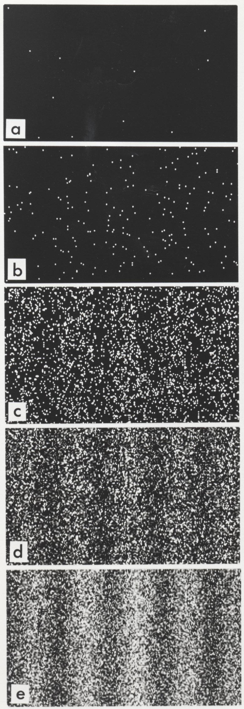

# De moleculaire oorsprong van chemische energie {#sec-ch-kwantum}

```{python}
#| include: false
# Figuren van dit hoofdstuk: zie _figuren/h2.py (stijl in _figuren/huisstijl.py)
import sys
sys.path.insert(0, "_figuren")
import h2 as fig
```

## Van de eerste hoofdwet naar de moleculaire schaal

In het vorige hoofdstuk hebben we de eerste wet van de thermodynamica ontwikkeld als een krachtig hulpmiddel om de energieverandering in fysische en chemische processen te beschrijven. Daarbij hebben we energie behandeld als een macroscopische, continue grootheid: we telden warmte en arbeid op, definieerden de interne energie $U$ en de enthalpie $H$, en gebruikten warmtecapaciteiten $C_p$ en $C_V$ om de temperatuursafhankelijkheid van deze grootheden te beschrijven. Deze aanpak is buitengewoon krachtig, maar zij is ook volledig *fenomenologisch*: de thermodynamica vertelt ons *hoeveel* energie tijdens een proces vrijkomt of wordt opgenomen, maar zij verklaart niet *waarom* verschillende stoffen een verschillende energie bezitten, en evenmin waarom een warmtecapaciteit een bepaalde waarde heeft of met de temperatuur varieert.

Waarom komt bij de reactie van waterstof met zuurstof zoveel energie vrij? Waarom is energie nodig om water opnieuw te ontbinden? Waarom is grafiet onder normale omstandigheden stabieler dan diamant, hoewel beide uitsluitend uit koolstofatomen bestaan?

De antwoorden op al deze vragen kunnen niet worden gevonden door uitsluitend naar de stof als geheel te kijken. Zij liggen verborgen op een veel kleinere schaal, namelijk in de opbouw van de atomen en moleculen waaruit de stof bestaat, en in de manier waarop deze deeltjes energie kunnen opnemen. Uiteindelijk worden alle chemische eigenschappen bepaald door de elektronen rond de atoomkernen, door de manier waarop deze elektronen chemische bindingen vormen, en door de bewegingsvrijheden -- translatie, rotatie en vibratie -- die een molecule als geheel bezit.

Dit hoofdstuk vormt daarom een noodzakelijke schakel tussen hoofdstuk [-@sec-ch-energie] en hoofdstuk [-@sec-ch-spontaniteit]. In hoofdstuk [-@sec-ch-energie] hebben we energie behandeld als een boekhoudkundige grootheid, zonder ons af te vragen waar zij vandaan komt. In dit hoofdstuk dalen we af naar de microscopische wereld van atomen en moleculen om te ontdekken dat energie op die schaal helemaal niet continu is, maar *gekwantiseerd*: enkel bepaalde, discrete energiewaarden zijn toegelaten. We zullen zien dat dit geldt voor de elektronen in een atoom (wat de chemische binding en de reactie-enthalpie verklaart), maar evenzeer voor de manier waarop een molecule als geheel kan bewegen: zij kan translateren, roteren en vibreren, en elk van deze bewegingsvormen blijkt eveneens gekwantiseerd te zijn, elk gekenmerkt door een eigen kwantumgetal.

Zodra we weten welke discrete energietoestanden een systeem van vele atomen en moleculen ter beschikking heeft, rijst immers een nieuwe vraag: *hoe verdelen al deze deeltjes zich over die toestanden bij een gegeven temperatuur?* Het antwoord op die vraag is statistisch van aard en leidt rechtstreeks naar het begrip *entropie*, het centrale thema van hoofdstuk [-@sec-ch-spontaniteit]. Het doel van dit hoofdstuk is dus niet om een volledige cursus kwantummechanica te ontwikkelen, maar om te begrijpen welke fundamentele ideeën aan de basis liggen van de moderne beschrijving van atomen en moleculen, en hoe deze ideeën uiteindelijk leiden tot chemische bindingen, moleculaire spectra en de energieverschillen die we in de thermodynamica beschrijven.

Het belang van deze kennis reikt bovendien ver voorbij dit hoofdstuk. De elektronenstructuur die we hier opbouwen, is bijvoorbeeld precies wat later bepaalt hoe sterk een molecule chemisch aan een katalysatoroppervlak bindt (chemisorptie, hoofdstuk [-@sec-ch-kinetiek]), en de energiebanden die ontstaan wanneer atomaire orbitalen zich in een kristal tot een vaste stof verenigen, liggen aan de basis van het onderscheid tussen geleiders, halfgeleiders en isolatoren (hoofdstuk [-@sec-ch-vastestof]). Kwantummechanica is dus geen geïsoleerd theoretisch intermezzo, maar het fundament waarop een groot deel van de latere, industrieel toepasbare hoofdstukken van deze cursus rust.

## Historische ontdekkingen: van klassieke fysica naar kwantummechanica

Vandaag lijkt het vanzelfsprekend dat alle materie is opgebouwd uit stabiele atomen, die zich via chemische bindingen tot moleculen verenigen. Aan het begin van de twintigste eeuw was dit echter allesbehalve vanzelfsprekend, en zelfs de stabiliteit van een enkel atoom vormde een onopgelost probleem.

### Van de klassieke fysica naar de kwantummechanica

Volgens de klassieke natuurkunde zou een elektron nooit langdurig rond een atoomkern kunnen bewegen. Een elektron bezit immers een elektrische lading. Wanneer een geladen deeltje een kromme baan volgt, ondergaat het voortdurend een versnelling. Volgens de elektromagnetische theorie van Maxwell zendt een versnellende elektrische lading elektromagnetische straling uit en verliest zij daarbij energie. De gevolgen hiervan zijn verstrekkend: indien een elektron voortdurend energie verliest, zal zijn baan steeds kleiner worden totdat het uiteindelijk op de atoomkern terechtkomt. De klassieke natuurkunde voorspelt dus dat stabiele atomen helemaal niet kunnen bestaan.

Er ontbreekt dus iets fundamenteels in de klassieke beschrijving van de natuur. De vraag die natuurkundigen zich moesten stellen was verrassend eenvoudig: wat als elektronen zich niet gedragen zoals de klassieke mechanica voorspelt? Gedurende meer dan twee eeuwen vormde de klassieke mechanica van Newton de basis van vrijwel alle natuurkundige berekeningen. Tegen het einde van de negentiende eeuw leek het alsof de natuurkunde vrijwel voltooid was. Juist op dat ogenblik begonnen echter experimenten te verschijnen die zich niet langer door de klassieke theorie lieten verklaren. De instabiliteit van het atoom vormde ëën van de eerste aanwijzingen, maar zeker niet de enige. Ook de straling die door warme voorwerpen wordt uitgezonden, het foto-elektrisch effect en de karakteristieke spectra van atomen bleken fundamenteel af te wijken van de voorspellingen van de klassieke fysica.

Gaandeweg werd duidelijk dat de klassieke natuurkunde niet fout was, maar een benadering vormde die uitstekend werkt voor macroscopische objecten. Op de schaal van atomen en elektronen gelden echter andere natuurwetten. Om de structuur van materie te begrijpen was daarom een volledig nieuwe theorie noodzakelijk. Deze theorie kreeg de naam *kwantummechanica*.

### Energie als discrete grootheid

Aan het einde van de negentiende eeuw leek de klassieke natuurkunde vrijwel voltooid. De bewegingswetten van Newton, de thermodynamica en de elektromagnetische theorie van Maxwell konden een groot aantal natuurkundige verschijnselen succesvol beschrijven. Toch bleef één hardnekkig probleem onopgelost: de straling die wordt uitgezonden door een warm voorwerp.

Een metalen staaf die wordt verwarmd, begint eerst donkerrood te gloeien. Bij een hogere temperatuur verandert de kleur geleidelijk naar oranje, vervolgens geel en uiteindelijk bijna wit. De kleur van het uitgezonden licht hangt dus rechtstreeks samen met de temperatuur van het voorwerp.

De natuurkundigen van die tijd wilden deze warmtestraling theoretisch beschrijven. Daartoe beschouwden zij een ideaal voorwerp dat alle invallende straling volledig absorbeert en opnieuw uitzendt. Een dergelijk voorwerp wordt een *zwart lichaam* genoemd. Het uitgestraalde spectrum van een zwart lichaam bleek experimenteel zeer nauwkeurig meetbaar en vormde daardoor een ideale test voor de bestaande theorieën.

De klassieke theorie voorspelde echter een fundamenteel verkeerd resultaat. Volgens de wetten van de klassieke elektromagnetica zouden de atomen in een warm voorwerp elektromagnetische golven met alle mogelijke frequenties kunnen uitzenden. Bovendien zou elke mogelijke trillingsmodus gemiddeld dezelfde hoeveelheid energie bevatten, overeenkomstig de equipartitiestelling uit de klassieke statistische mechanica.

Het aantal mogelijke trillingsmodi neemt echter zeer sterk toe naarmate de frequentie groter wordt. De klassieke theorie voorspelde daardoor dat vooral straling met een zeer hoge frequentie, zoals ultraviolet licht, een enorme hoeveelheid energie zou bevatten. Wiskundig leidde de theorie zelfs tot de absurde conclusie dat de totale uitgestraalde energie oneindig groot moest zijn.

Dit resultaat staat bekend als de *ultravioletcatastrofe*, ook wel de Rayleigh-Jeans-catastrofe. De voorspelling was duidelijk in tegenspraak met experimenten. In werkelijkheid neemt de intensiteit van de warmtestraling na een bepaalde frequentie juist sterk af, zodat slechts een beperkte hoeveelheid energie wordt uitgestraald (zie Figuur [-@fig-uvcatastrophe]).

::: {#fig-uvcatastrophe}
```{python}
#| out-width: 80%
#| renderings: [light, dark]
fig.toon(fig.uv_catastrofe)
```

De Ultravioletcatastrofe is de fout bij korte golflengten in de wet van Rayleigh-Jeans voor uitgestraalde energie door een ideaal zwart-lichaam. De fout, die veel meer uitgesproken is voor korte golflengten, is het verschil tussen de zwarte kromme (de verkeerde kromme die wordt voorspeld door de wet van Rayleigh-Jeans) en de blauwe kromme (de correcte kromme die wordt voorspeld door de wet van Planck).
:::

De vraag was dus fundamenteel: *waarom straalt een warm voorwerp geen oneindige hoeveelheid hoogfrequente straling uit?* In 1900 stelde de Duitse natuurkundige Max Planck een gedurfde hypothese voor. Hij veronderstelde dat de atomen in een warm voorwerp niet willekeurig energie kunnen opnemen of afgeven. De uitwisseling van energie gebeurt uitsluitend in kleine, ondeelbare pakketjes, die later *kwanta* werden genoemd.

$$\boxed{
E=h\nu=h\frac{c}{\lambda}
}$$ waarin $h$ de constante van Planck is ($h=6.626\times10^{-34}\;\mathrm{J}\,\mathrm{s}$), $\nu$ de frequentie van de elektromagnetische straling voorstelt, $\lambda$ de golflengte van de elektromagnetische straling en $c$ de lichtsnelheid.

Deze eenvoudige hypothese had verstrekkende gevolgen. Voor laagfrequente straling is de energie van één quantum klein, zodat vele energietoestanden gemakkelijk bereikbaar zijn. Bij zeer hoge frequenties wordt de energie van één quantum echter veel groter. De trillende deeltjes beschikken dan vaak niet over voldoende energie om een dergelijk quantum uit te zenden. Hierdoor wordt de emissie van hoogfrequente straling automatisch onderdrukt. De experimenteel waargenomen afname van de intensiteit bij hoge frequenties volgde daardoor vanzelf uit Plancks theorie. Zijn vergelijking beschreef het volledige spectrum van de warmtestraling met een nauwkeurigheid die voordien onmogelijk was.

Hoewel Planck zijn hypothese aanvankelijk vooral als een mathematische truc beschouwde, bleek het later een fundamentele eigenschap van de natuur te beschrijven. Voor het eerst werd het klassieke idee verlaten dat energie een volledig continue grootheid is. Op macroscopische schaal zijn de energiekwanta zo klein dat energie continu *lijkt* te veranderen. Op atomaire schaal worden deze energiestappen echter bepalend voor het gedrag van materie. Hierdoor zijn de klassieke mechanica en de kwantummechanica geen afzonderlijke theorieën, maar veeleer een mooie aanvulling op elkaar.

::: {.callout-tip}
## Voorbeeld: Fotonenergie over het elektromagnetisch spectrum

Om een gevoel te krijgen voor de grootteorde van $E=h\nu$, vergelijken we de energie van één foton voor drie golflengten: een FM-radiogolf ($\lambda=3\,\mathrm{m}$), zichtbaar groen licht ($\lambda=520\,\mathrm{nm}$) en een röntgenfoton ($\lambda=0.1\,\mathrm{nm}$).

Met $E=hc/\lambda$ en $h=6.626\times10^{-34}\,\mathrm{J}\,\mathrm{s}$, $c=3.00\times10^{8}\,\mathrm{m}\,\mathrm{s}^{-1}$:

$$\begin{aligned}
E_{\text{radio}} &= \frac{(6.626\times10^{-34})(3.00\times10^{8})}{3} = 6.63\times10^{-26}\,\mathrm{J} \\{}[2mm]
E_{\text{groen}} &= \frac{(6.626\times10^{-34})(3.00\times10^{8})}{520\times10^{-9}} = 3.82\times10^{-19}\,\mathrm{J} \\{}[2mm]
E_{\text{X-ray}} &= \frac{(6.626\times10^{-34})(3.00\times10^{8})}{0.1\times10^{-9}} = 1.99\times10^{-15}\,\mathrm{J}
\end{aligned}$$

Tussen een radiogolf en een röntgenfoton zit dus een factor van ongeveer $10^{10}$ in energie, hoewel beide "gewoon" elektromagnetische straling zijn. Dit verklaart meteen waarom radiogolven volledig onschadelijk zijn voor chemische bindingen (energie per foton veel kleiner dan een bindingsenergie), terwijl röntgenstraling en ultraviolet licht chemische bindingen kunnen breken of elektronen kunnen losmaken: hun fotonenergie ligt in dezelfde grootteorde als de energieverschillen tussen elektronische toestanden in atomen en moleculen.
:::

::: {#fig-spectrum-bindingen}
```{python}
#| out-width: 85%
#| renderings: [light, dark]
fig.toon(fig.spectrum_bindingen)
```

Energie van één mol fotonen over het elektromagnetisch spectrum, vergeleken met enkele bindingsenergieën en met $RT$ bij kamertemperatuur. Ultraviolet licht heeft genoeg energie om C--C-bindingen te breken (zonnebrand, vergeelde kunststof); infrarood en microgolven doen moleculen enkel sneller trillen en draaien.
:::

### Het foto-elektrisch effect

Hoewel de hypothese van Planck het spectrum van een zwart lichaam perfect kon beschrijven, bleef onduidelijk of de energiekwanta werkelijk een fysische betekenis hadden. In 1905 gaf Albert Einstein aan Plancks idee een veel diepere betekenis. Hij stelde voor dat elektromagnetische straling niet alleen in discrete hoeveelheden wordt uitgezonden of geabsorbeerd, maar dat het zelf uit afzonderlijke energiepakketjes bestaat. Elk van deze pakketjes, later *fotonen* genoemd, bezit dezelfde gekwantiseerde energie als Planck postuleerde, $E=h\nu$.

Deze hypothese bood een verklaring voor het foto-elektrisch effect. Wanneer elektromagnetische straling op een metalen oppervlak valt, kunnen elektronen uit het metaal worden vrijgemaakt. Klassiek zou men verwachten dat een grotere lichtintensiteit de elektronen steeds meer energie geeft, ongeacht de golflengte (kleur) van het licht. Experimenten tonen echter een volledig ander gedrag.

1.  Onder een bepaalde drempelfrequentie worden helemaal geen elektronen uitgestoten, zelfs niet wanneer de lichtintensiteit zeer groot is.
2.  Zodra de frequentie boven deze drempel komt, worden de elektronen vrijwel onmiddellijk vrijgemaakt.
3.  De maximale kinetische energie van de uitgestoten elektronen hangt uitsluitend af van de frequentie van het invallende licht en niet van de lichtintensiteit.

::: {#fig-photoelectric}
```{python}
#| out-width: 50%
#| renderings: [light, dark]
fig.toon(fig.foto_elektrisch)
```

Een invallende elektromagnetische straling met energie $h \nu$ is in staat om een elektron uit het metaal te verwijderen. Hiervoor wordt de energie enerzijds gebruikt om te ontsnappen uit het metaal ($\Phi$) en anderzijds om het elektron te versnellen ($E_k$).
:::

Einstein verklaarde deze waarnemingen door aan te nemen dat één elektron telkens slechts één foton absorbeert. Een deel van de energie van dit foton is nodig om het elektron uit het metaal los te maken. Deze minimale energie wordt de *werkfunctie* genoemd en wordt aangeduid met $\Phi$. Wanneer de energie van het foton groter is dan de werkfunctie, blijft het overschot over als kinetische energie van het uitgestoten elektron. Dit leidt tot de vergelijking van Einstein (zie Figuur [-@fig-photoelectric]):

$$h\nu = \Phi + E_{\mathrm{kin,max}}$$

of

$$E_{\mathrm{kin,max}} = \frac{1}{2}m_ev^2  = h\nu-\Phi$$

De werkfunctie is een materiaaleigenschap. Typische waarden liggen tussen ongeveer $2\,\mathrm{eV}$ - $5\,\mathrm{eV}$, afhankelijk van het gebruikte metaal. Een elektronvolt is de hoeveelheid kinetische energie die 1 elektron krijgt als het een spanningsverschil van 1 volt doorloopt. Eén elektronvolt is gelijk aan ongeveer $1.602\times10^{-19}\,\mathrm{J}$.

::: {#fig-ek-frequentie}
```{python}
#| out-width: 55%
#| renderings: [light, dark]
fig.toon(fig.ek_frequentie)
```

Maximale kinetische energie van de uitgestoten elektronen in functie van de frequentie van het invallende licht, voor natrium en koper. Onder de drempelfrequentie $\nu_0 = \Phi/h$ komen geen elektronen vrij; daarboven stijgt $E_{\mathrm{kin,max}}$ lineair met helling $h$, voor elk metaal dezelfde.
:::

::: {.callout-tip}
## Voorbeeld: Foto-elektrisch effect

Een natriumoppervlak heeft een werkfunctie van $\Phi=2.30\,\mathrm{eV}$. Het wordt bestraald met ultraviolet licht met een golflengte van $\lambda=250\,\mathrm{nm}$.

De energie van één foton bij die golflengte bedraagt

$$E=\frac{hc}{\lambda}.$$

Invullen geeft

$$\begin{aligned}
E
&=
\frac{(6.626\times10^{-34}\,\mathrm{J}\,\mathrm{,s})
(3.00\times10^{8}\,\mathrm{m/s})}
{250\times10^{-9}\,\mathrm{m}}
\
&=
7.95\times10^{-19}\,\mathrm{J}
\
&=
4.96\,\mathrm{eV}.
\end{aligned}$$

De maximale kinetische energie van het elektron bedraagt bijgevolg

$$E_{\mathrm{kin,max}}
=
4.96-2.30
=
2.66\,\mathrm{eV}$$

Het elektron wordt dus uit het metaal losgemaakt en verlaat het oppervlak met een kinetische energie van $2.66\,\mathrm{eV}$.
:::

De werkfunctie mag niet worden verward met de ionisatie-energie. De *werkfunctie* is de minimale energie die nodig is om een elektron uit een vast metaal los te maken. Het elektron bevond zich reeds in de geleidingsband van het metaal en hoeft enkel het oppervlak te verlaten. De *ionisatie-energie* is de energie die nodig is om een elektron volledig uit een geïsoleerd atoom of molecuul te verwijderen. Hierbij moet de volledige aantrekkingskracht van de atoomkern worden overwonnen. Omdat een elektron in een metaal reeds relatief vrij kan bewegen, is de werkfunctie doorgaans aanzienlijk kleiner dan de ionisatie-energie van hetzelfde element. Zo bedraagt de werkfunctie van natrium ongeveer $2.3\,\mathrm{eV}$, terwijl de eerste ionisatie-energie ongeveer $5.1\,\mathrm{eV}$ bedraagt.

De verklaring van het foto-elektrisch effect vormde een van de eerste overtuigende bewijzen dat licht zich niet alleen als een golf, maar ook als een verzameling deeltjes kan gedragen. Samen met Plancks hypothese vormde dit het vertrekpunt voor de ontwikkeling van de moderne kwantummechanica.

### Het model van Bohr {#sec-bohr}

Reeds in de negentiende eeuw was experimenteel bekend dat verhit waterstofgas licht uitzendt bij slechts een beperkt aantal scherp bepaalde golflengten; een *lijnenspectrum*; in plaats van een continu spectrum zoals bij een gloeiende metalen staaf. In 1885 vond de Zwitserse wiskundige Johann Balmer een eenvoudige, zuiver empirische formule die de golflengten van de toen gekende zichtbare lijnen van waterstof nauwkeurig beschreef, zonder dat er op dat ogenblik enige fysische verklaring voor bestond. Precies dit raadsel, waarom zendt waterstof licht uit bij deze en geen andere golflengten, vormde de uitdaging waarvoor Bohr in 1913 een eerste theoretische verklaring zou geven. Zijn model is historisch van groot belang: het vormt de brug tussen de klassieke natuurkunde en de kwantummechanica, en het introduceert voor het eerst het idee dat ook het impulsmoment van het elektron gekwantiseerd zou kunnen zijn.

Bohr vertrok van het klassieke beeld van een elektron dat in een cirkelvormige baan rond de kern beweegt, gehouden door de Coulombaantrekking, maar voegde daaraan een niet-klassiek postulaat toe: enkel die banen zijn toegelaten waarvoor het impulsmoment een geheel veelvoud is van $\hbar= \frac{h}{2 \pi}$, $$p r = m_ev r = n\hbar, \qquad n=1,2,3,\ldots$$ Door deze kwantisatievoorwaarde te combineren met de klassieke voorwaarde dat de Coulombkracht precies de centripetale kracht levert, $\dfrac{e^2}{4\pi\varepsilon_0r^2}=\dfrac{m_ev^2}{r}$, volgen zowel de toegelaten baanstralen als de bijbehorende energieën: $$r_n = n^2a_0, \qquad a_0=\frac{4\pi\varepsilon_0\hbar^2}{m_ee^2}\approx52.9\,\mathrm{pm} \quad\text{(de Bohr-straal)},$$ $$E_n = -\frac{m_ee^4}{8\varepsilon_0^2h^2}\frac{1}{n^2} = -\frac{13{,}6~\mathrm{eV}}{n^2}, \qquad n=1,2,3,\ldots$$ Deze laatste uitdrukking is exact dezelfde vergelijking die we verderop ([-@sec-waterstofatoom]) via de Schrödingervergelijking zullen terugvinden. Bohrs model gaf dus, ondanks zijn eenvoudige en deels ad-hoc karakter, reeds het volledig correcte energiespectrum van het waterstofatoom, en daarmee automatisch ook de correcte Rydberg-formule voor het waterstofspectrum ([-@sec-atomaire-spectra]).

::: {#fig-bohr-model}
```{python}
#| out-width: 60%
#| renderings: [light, dark]
fig.toon(fig.bohr)
```

Schematische voorstelling van het model van Bohr.
:::

Toch bleek het model van Bohr uiteindelijk ontoereikend, om drie fundamentele redenen:

1.  Het werkt uitsluitend voor waterstofachtige systemen met precies ëën elektron ($\mathrm{H}$, $\mathrm{He^+}$, $\mathrm{Li^{2+}}$,...); voor elk atoom met meer dan ëën elektron levert het geen correcte voorspellingen, omdat het geen rekening houdt met de onderlinge afstoting tussen elektronen.
2.  De kwantisatievoorwaarde $m_evr=n\hbar$ wordt zonder diepere rechtvaardiging *opgelegd*: het model verklaart niet *waarom* enkel deze banen zijn toegelaten, het stelt dit gewoon vast omdat het de juiste antwoorden oplevert.
3.  Het model beschrijft het elektron nog steeds als een klassiek deeltje met een precieze positie en snelheid op een welbepaalde baan --- een beeld dat, zoals we in [-@sec-dubbelspleet] zullen zien, fundamenteel onverenigbaar is met het golfkarakter van materie.

Deze tekortkomingen tonen aan dat een eenvoudige aanpassing van de klassieke mechanica niet volstaat. Er was een volledig nieuw theoretisch kader nodig, waarin kwantisatie niet langer als extra postulaat wordt toegevoegd, maar automatisch uit de fundamentele vergelijkingen zelf volgt. De eerste stap naar dat kader werd gezet door Louis de Broglie.

### Het golfkarakter van materie

Het voorstel van Planck betekende een revolutionaire stap vooruit, maar veranderde aanvankelijk nog niets aan het beeld dat natuurkundigen van materie hadden. Licht werd beschouwd als een elektromagnetische golf, terwijl elektronen en andere materiedeeltjes werden voorgesteld als kleine, duidelijk gelokaliseerde deeltjes.

Dat onderscheid werd al snel minder vanzelfsprekend. Einstein had in 1905 door het foto-elektrisch effect aangetoond dat licht zich in bepaalde omstandigheden ook gedraagt alsof het uit afzonderlijke energiepakketjes bestaat. Licht, dat traditioneel als een golf werd beschouwd, vertoonde dus eveneens een deeltjeskarakter.

In 1924 stelde Louis de Broglie voor dat deze dualiteit ook in de omgekeerde richting moest gelden. Wanneer licht zowel golf- als deeltjeseigenschappen kan vertonen, dan zou materie mogelijk eveneens een golfkarakter bezitten. Hij veronderstelde dat aan ieder deeltje met impuls $p$ een golflengte kan worden toegekend:

$$\boxed{
\lambda=\frac{h}{p}
}$$ waarin $h$ de constante van Planck is en $p$ de impuls van het deeltje. Voor een niet-relativistisch deeltje met massa $m$ en snelheid $v$ geldt $$p=mv$$ zodat de de Broglie-golflengte ook kan worden geschreven als $$\lambda=\frac{h}{mv}$$

De de Broglie-golflengte betekent niet dat een elektron letterlijk als een kleine, materiële golf door de ruimte beweegt. Zij geeft aan dat het gedrag van een deeltje door een golffunctie moet worden beschreven en dat het onder geschikte omstandigheden verschijnselen zoals interferentie en diffractie kan vertonen.

Voor macroscopische voorwerpen is de impuls zo groot dat de bijbehorende golflengte onvoorstelbaar klein wordt. Het golfkarakter is dan experimenteel niet waarneembaar. Voor elektronen op atomaire schaal kan de de Broglie-golflengte daarentegen vergelijkbaar zijn met de afstand tussen atomen. Daardoor kunnen elektronen worden afgebogen door de regelmatige structuur van een kristal, op een vergelijkbare manier als röntgenstraling.

::: {.callout-tip}
## Voorbeeld: De de Broglie-golflengte van een elektron en een wandelende persoon

We vergelijken de golflengte van een elektron dat door een elektrisch potentiaalverschil wordt versneld met die van een wandelende persoon.

**1. Elektron versneld over $150\,\mathrm{V}$**

Een elektron dat vanuit rust over een potentiaalverschil $U$ wordt versneld, neemt een kinetische energie op gelijk aan

$$E_{\mathrm{kin}}=eU,$$

waarin $e$ de elementaire lading is. Voor niet-relativistische snelheden geldt eveneens

$$E_{\mathrm{kin}}= \frac{1}{2}m_ev^2 =\frac{p^2}{2m_e}.$$

De impuls van het elektron kan daarom worden berekend uit

$$p=\sqrt{2m_e eU}$$

De de Broglie-golflengte wordt dan

$$\lambda = \frac{h}{\sqrt{2m_e eU}}$$

Met $$h=6.626\times10^{-34}\,\mathrm{J}\,\mathrm{s}, \qquad m_e=9.109\times10^{-31}\,\mathrm{kg}, \qquad e=1.602\times10^{-19}\,\mathrm{C}$$ en $$U=150\,\mathrm{V}$$ volgt $$\begin{aligned}
\lambda
&=
\frac{6.626\times10^{-34}\,\mathrm{J}\,\mathrm{s}}
{\sqrt{
2
(9.109\times10^{-31}\,\mathrm{kg})
(1.602\times10^{-19}\,\mathrm{C})
(150\,\mathrm{V})
}}
\\{}[2mm]
&=
1.00\times10^{-10}\,\mathrm{m}
\end{aligned}$$

Bijgevolg is

$$\lambda_{\mathrm{elektron}} \approx 0.100\,\mathrm{nm}$$

Deze golflengte is van dezelfde orde van grootte als de afstand tussen atomen in een kristal. Elektronen met deze energie kunnen daarom duidelijke diffractiepatronen veroorzaken. Dit vormt een rechtstreeks experimenteel bewijs voor het golfkarakter van materie.

**2. Een wandelende persoon**

Beschouw vervolgens een persoon met een massa van $$m=75\,\mathrm{kg}$$ die wandelt met een snelheid van $$v=1.5\,\mathrm{m}\,\mathrm{s}^{-1} = 5.5\,\mathrm{km}\,\mathrm{h}^{-1}$$ De impuls bedraagt $$p=mv
=
(75\,\mathrm{kg})
(1.5\,\mathrm{m}\,\mathrm{s}^{-1})
=
112.5\,\mathrm{kg}\,\mathrm{m}\,\mathrm{s}^{-1}.$$

De bijbehorende de Broglie-golflengte is

$$\begin{aligned}
\lambda
&=
\frac{h}{mv}
\
&=
\frac{6.626\times10^{-34}\,\mathrm{J}\,\mathrm{s}}
{(75\,\mathrm{kg})(1.5\,\mathrm{m}\,\mathrm{s}^{-1})}
\
&=
5.89\times10^{-36}\,\mathrm{m}.
\end{aligned}$$

Dus

$$\lambda_{\mathrm{persoon}}
\approx
5.9\times10^{-36}\,\mathrm{m}$$

Deze golflengte is vele ordes van grootte kleiner dan de afmetingen van een atoom of zelfs van een atoomkern. Het golfkarakter van een wandelende persoon is daarom in de praktijk volledig onwaarneembaar.
De vergelijking toont dat de de Broglie-relatie in principe voor alle materie geldt. Alleen bij deeltjes met een zeer kleine massa en impuls, zoals elektronen, wordt de golflengte groot genoeg om meetbare golfverschijnselen te veroorzaken.
:::

### De dubbelspleetproef {#sec-dubbelspleet}

De hypothese van De Broglie werd spoedig experimenteel bevestigd. Wanneer een elektronenbundel door een plaat met twee fijne spleten wordt gestuurd, ontstaat op een scherm achter de spleten een patroon dat typisch is voor golven: een afwisseling van heldere en donkere banden (diffractiepatroon). Dit patroon kan alleen worden verklaard wanneer de elektronen zich als golven gedragen.

Wanneer de proef met ëën elektron tegelijk wordt uitgevoerd, verschijnt telkens slechts ëën punt op het scherm. Pas na vele elektronen ontstaat het golfpatroon langzaam. Elk afzonderlijk elektron wordt dus als deeltje gedetecteerd, maar de verdeling van de detectiepunten vertoont een golfkarakter.

{#fig-dubbelespleet width="30%"}

## De golffunctie en de Schrödingervergelijking

### De golffunctie {#sec-golffunctie}

Het dubbelespleetexperiment toont dat het gedrag van elektronen niet volledig kan worden beschreven met het klassieke beeld van een deeltje dat op ieder ogenblik een welbepaalde baan volgt. Om het golfkarakter van een elektron wiskundig te beschrijven, wordt in de kwantummechanica een *golffunctie* ingevoerd, die wordt aangeduid met het symbool $\psi$.

De golffunctie bevat alle informatie die binnen de kwantummechanica over de toestand van het elektron beschikbaar is en kan afhangen van de positie en van de tijd:

$$\psi=\psi(\vec{r},t).$$

De waarde van $\psi$ zelf is in het algemeen geen rechtstreeks meetbare fysische grootheid. De golffunctie kan bovendien complex zijn, zodat zij zowel een reëel als een imaginair deel kan bevatten. Om uit de golffunctie een meetbare voorspelling af te leiden, is daarom een interpretatieregel nodig.

De fysische betekenis van de golffunctie werd in 1926 verduidelijkt door Max Born. Hij stelde voor om $\psi$ niet te interpreteren als een materiële golf die door de ruimte is uitgesmeerd. In plaats daarvan bepaalt de golffunctie de waarschijnlijkheid waarmee een elektron op een bepaalde plaats kan worden waargenomen.

De grootheid

$$|\psi(\vec{r},t)|^2
=
\psi^*(\vec{r},t)\psi(\vec{r},t)$$

wordt de *waarschijnlijkheidsdichtheid* genoemd. Hierin is $\psi^*$ de complex geconjugeerde van de golffunctie. De kans om het elektron op tijdstip $t$ aan te treffen in een klein volume-element $\dd V$ rond de positie $\vec{r}$ is

$$\boxed{
\dd P
=
|\psi(\vec{r},t)|^2\,\dd V.
}$$

De kans om het elektron in een groter gebied $\Omega$ aan te treffen, wordt verkregen door de waarschijnlijkheidsdichtheid over dat gebied te integreren:

$$P_{\Omega}
=
\int_{\Omega}
|\psi(\vec{r},t)|^2\,\dd V.$$

Omdat het elektron zich ergens in de ruimte moet bevinden, moet de totale waarschijnlijkheid gelijk zijn aan één:

$$\int_{\text{volledige ruimte}}
|\psi(\vec{r},t)|^2\,\dd V
=
1.$$

Een golffunctie die aan deze voorwaarde voldoet, wordt *genormaliseerd* genoemd.

De kwantummechanica voorspelt dus in het algemeen niet waar een individueel elektron bij een meting zal worden aangetroffen. Zij voorspelt wel met welke waarschijnlijkheid de verschillende mogelijke meetresultaten zullen optreden. Wanneer hetzelfde experiment zeer vaak onder identieke omstandigheden wordt uitgevoerd, ontstaat een verdeling die overeenkomt met $|\psi|^2$.

Dit verklaart ook het diffractiepatroon in het dubbelespleetexperiment. Elk elektron wordt bij detectie als een afzonderlijk deeltje op één welbepaalde plaats waargenomen. De verdeling van een groot aantal inslagen wordt echter bepaald door de golffunctie en vertoont daardoor een diffractiepatroon.

Deze probabilistische interpretatie is niet zomaar een wiskundige bijzaak: zij is de eerste keer in dit hoofdstuk dat waarschijnlijkheid een fundamentele rol speelt in de beschrijving van de natuur, in plaats van louter een gevolg te zijn van onze onwetendheid. In hoofdstuk [-@sec-ch-spontaniteit] zullen we zien dat exact dezelfde idee -- een groot aantal mogelijke toestanden waarover een systeem zich verdeelt volgens een waarschijnlijkheid -- aan de basis ligt van de entropie.

### Van golffunctie naar orbitaal

Een *atomair orbitaal* is een toegelaten ruimtelijke golffunctie voor een elektron in een atoom. Een orbitaal is dus geen baan waarlangs het elektron rond de kern beweegt, zoals in het klassieke model van Bohr. Het is een gebied met een statistische kans om het elektron aan te treffen. Wanneer deze waarschijnlijkheidsdichtheid in drie dimensies wordt weergegeven, ontstaat de voorstelling van een elektronenwolk. Zo'n elektronenwolk mag niet worden geïnterpreteerd als een materiële wolk waarin de lading van het elektron letterlijk over de ruimte is verspreid. Zij toont in welke gebieden rond de kern de kans om het elektron aan te treffen groot of klein is.

In de praktijk worden orbitalen vaak voorgesteld door een oppervlak dat een bepaald percentage, bijvoorbeeld $90\,\%$ of $95\,\%$, van de totale waarschijnlijkheid omsluit. De vorm van dit oppervlak hangt af van de vorm van de golffunctie. Op die manier ontstaan de karakteristieke vormen van $s$-, $p$- en andere orbitalen (zie Figuur [-@fig-orbitalen]).

::: {#fig-orbitalen}
```{python}
#| out-width: 90%
#| renderings: [light, dark]
fig.toon(fig.orbitalen)
```

Typische waarschijnlijkheidsverdelingen voor verschillende golffuncties.
:::

### De Schrödingervergelijking

De vergelijking waarmee de mogelijke golffuncties van een kwantummechanisch systeem worden bepaald, werd in 1926 door Erwin Schrödinger voorgesteld. Voor één elektron in een één dimensionale ruimte en in een toestand met een welbepaalde energie luidt de tijdsonafhankelijke Schrödingervergelijking:

$$\boxed{
-\frac{\hbar^2}{2m}
\frac{\partial^2\psi}{\partial x^2}
+
V(x)\psi
=
E\psi,
}$$ {#eq-schrodinger}

waarin $\hbar=h/(2\pi)$ de gereduceerde constante van Planck is, $m$ de massa van het beschouwde deeltje, $V(x)$ de potentiële energie en $E$ de totale energie.

De Schrödingervergelijking is voor de kwantummechanica wat de bewegingswetten van Newton zijn voor de klassieke mechanica. De vergelijking levert echter niet rechtstreeks de baan of de exacte positie van een deeltje. Haar oplossingen zijn de golffuncties die voor het beschouwde systeem mogelijk zijn. Niet elke willekeurige golffunctie vormt een fysisch aanvaardbare oplossing. Drie voorwaarden moeten voldaan zijn:

-   **Eindig**: $\psi$ mag nergens naar oneindig gaan, want $|\psi|^2$ zou dan een oneindige waarschijnlijkheidsdichtheid impliceren op die plaats hetgeen fysisch onmogelijk is.
-   **Continu**: $\psi$ (en, voor een eindige potentiaal, ook haar eerste afgeleide) mag geen abrupte sprongen vertonen. De Schrödingervergelijking bevat immers een *tweede* afgeleide van $\psi$; die is enkel gedefinieerd wanneer $\psi$ zelf voldoende vloeiend verloopt.
-   **Normaliseerbaar**: de totale waarschijnlijkheid om het deeltje ergens in de ruimte aan te treffen moet gelijk zijn aan 1 ([-@sec-golffunctie]), wat vereist dat $|\psi|^2$ over de volledige ruimte convergeert; voor een gebonden toestand moet $\psi$ dus naar nul gaan op grote afstand.

Door deze voorwaarden zijn voor gebonden systemen vaak slechts bepaalde golffuncties en bepaalde energiewaarden toegestaan. De bijbehorende energieën zijn hierdoor gekwantiseerd.

Voor een elektron in een atoom wordt de potentiële energie hoofdzakelijk bepaald door de elektrostatische aantrekking tussen het negatief geladen elektron en de positief geladen kern. De oplossingen van de Schrödingervergelijking voor deze potentiële energie leveren de atomaire orbitalen en de bijbehorende energieniveaus. Verderop in dit hoofdstuk ([-@sec-moleculaire-beweging]) passen we exact dezelfde vergelijking toe op heel andere potentialen; een deeltje dat vrij kan bewegen in een begrensde ruimte, en een molecule die roteert of vibreert. We zullen zien dat ook daar automatisch discrete energieniveaus en nieuwe kwantumgetallen uit de vergelijking volgen.

De stabiliteit van het atoom volgt daarmee niet uit het beeld van een elektron dat in een klassieke baan rond de kern beweegt. Een stabiele atomaire toestand wordt beschreven door een genormaliseerde golffunctie met een welbepaalde energie. De laagste toegelaten oplossing is de grondtoestand. Een toestand waarin het elektron onbeperkt op de kern zou instorten, behoort niet tot de fysisch toegelaten stationaire oplossingen.

### Discrete energieniveaus {#sec-discrete-energieniveaus}

Een opmerkelijk gevolg van de Schrödingervergelijking is dat slechts een beperkt aantal oplossingen fysisch toegelaten is. Niet elke willekeurige golffunctie voldoet immers aan de randvoorwaarden van het probleem. Alleen golven die op een consistente manier rond de atoomkern kunnen bestaan, blijken stabiele oplossingen te vormen.

Dit kan worden begrepen door een vergelijking te maken met een trillende gitaarsnaar. Wanneer een snaar aan beide uiteinden is vastgemaakt, kan zij niet willekeurig trillen. Slechts bepaalde trillingspatronen zijn mogelijk. Voor de materiegolf van een elektron geldt een gelijkaardig principe: slechts een beperkt aantal golffuncties is mogelijk. Aangezien iedere toegelaten golffunctie overeenkomt met ëën welbepaalde energie, volgt automatisch dat ook slechts een beperkt aantal energieniveaus bestaat.

Deze analogie kan onmiddellijk wiskundig concreet gemaakt worden aan de hand van het eenvoudigst mogelijke voorbeeld: een deeltje met massa $m$ dat vrij kan bewegen binnen een ééndimensionale "doos" met lengte $L$, en de wanden van de doos niet kan verlaten ($V=0$ binnen de doos, $V=\infty$ daarbuiten). Binnen de doos herleidt de Schrödingervergelijking zich tot $$-\frac{\hbar^2}{2m}\frac{\dd^2\psi}{\dd x^2} = E\psi,$$ met als algemene oplossing $\psi(x)=A\sin(kx)+B\cos(kx)$, waarin $k=\sqrt{2mE}/\hbar$. Omdat het deeltje de wanden niet kan verlaten, moet $\psi$ daar continu aansluiten bij de waarde nul erbuiten (de *continuïteitsvoorwaarde* hierboven): $\psi(0)=0$ en $\psi(L)=0$. De eerste voorwaarde geeft onmiddellijk $B=0$. De tweede voorwaarde, $A\sin(kL)=0$, kan voor een niet-triviale golffunctie met $A\neq0$ enkel voldaan zijn wanneer $$kL = n\pi, \qquad n=1,2,3,\ldots,$$ exact zoals bij een trillende snaar met vaste uiteinden, die enkel staande golven toelaat met een geheel aantal halve golflengten tussen de vaste punten. Substitutie van $k=n\pi/L$ in $E=\hbar^2k^2/(2m)$ levert de gekwantiseerde energie: $$E_n = \frac{n^2h^2}{8mL^2}, \qquad n=1,2,3,\ldots$$ {#eq-deeltje-in-doos} De kwantisatie volgt hier dus rechtstreeks en uitsluitend uit de randvoorwaarden $\psi(0)=\psi(L)=0$; geen enkele extra aanname was nodig. Dit eenvoudige model, het *deeltje in een doos*, is niet zomaar een wiskundige oefening: we passen het verderop in dit hoofdstuk ([-@sec-translatie]) rechtstreeks toe om de gekwantiseerde translatie-energie van een molecule te beschrijven.

Zonder bijkomende hypothesen verklaart dezelfde theorie zowel de stabiliteit van atomen als het bestaan van discrete spectraallijnen. Eigenschappen die binnen de klassieke fysica volledig onverklaarbaar bleken, blijken rechtstreeks voort te vloeien uit het golfkarakter van elektronen. We zullen in [-@sec-atomaire-spectra] zien dat exact deze discrete energieniveaus rechtstreeks aanleiding geven tot de karakteristieke lijnenspectra waarmee atomen en moleculen experimenteel geïdentificeerd worden.

## Het waterstofatoom en atomaire spectra

### Het waterstofatoom en zijn energieniveaus {#sec-waterstofatoom}

De Schrödingervergelijking kan voor het waterstofatoom exact analytisch worden opgelost. Dit doen we analoog aan het 'deeltje in een doos' voorbeeld van hierboven maar dan met een potentiële energie die overeenkomt met de Coulombpotentiaal ($V(r)= -\frac{e^2}{4 \pi \epsilon_0 r}$). De resulterende energieniveaus blijken ook hier uitsluitend af te hangen van het hoofdkwantumgetal $n$: $$E_n = -\frac{13{,}6~\mathrm{eV}}{n^2}, \qquad n = 1,2,3,\ldots$$ De negatieve waarde duidt erop dat het elektron aan de kern gebonden is: positieve energie zou een vrij (ongebonden) elektron betekenen.

De laagste energie, de *grondtoestand*, correspondeert met $n=1$ en bedraagt $E_1 = -13{,}6~\mathrm{eV}$. Voor $n=2$ geldt $E_2 = -3{,}4~\mathrm{eV}$, voor $n=3$ geldt $E_3 = -1{,}51~\mathrm{eV}$, enzovoort. Naarmate $n$ groter wordt, nadert de energie aan nul: het elektron wordt steeds zwakker gebonden.

::: {.callout-tip}
## Voorbeeld: Energie van een foton bij de overgang $n=2 \to n=1$

Wanneer een waterstofatoom terugvalt van de eerste aangeslagen toestand ($n=2$) naar de grondtoestand ($n=1$), wordt het energieverschil uitgezonden als een foton: $$\Delta E = E_2 - E_1 = -3{,}4 - (-13{,}6) = 10{,}2~\mathrm{eV}.$$ Met $E = hc/\lambda$ volgt de golflengte van dit foton: $$\lambda = \frac{hc}{\Delta E} = \frac{(6{,}626\times 10^{-34})(2{,}998\times 10^{8})}{(10{,}2)(1{,}602\times 10^{-19})} \approx 1{,}22 \times 10^{-7}~\mathrm{m} = 122\,\mathrm{nm}.$$ Dit is de eerste lijn van het Lyman-reeks, in het ultraviolette deel van het spectrum. Deze berekening toont concreet hoe het golfkarakter van het elektron leidt tot discrete spectraallijnen die experimenteel kunnen worden gemeten.
:::

### Atomaire spectra: van energieniveaus naar spectraallijnen {#sec-atomaire-spectra}

Het voorbeeld hierboven illustreert een algemeen principe dat veel breder toepasbaar is dan het waterstofatoom alleen: telkens wanneer een elektron overgaat van een hoger naar een lager energieniveau, wordt het energieverschil uitgezonden als een foton met een welbepaalde frequentie. Omgekeerd kan een atoom een foton absorberen, op voorwaarde dat de fotonenergie exact overeenkomt met het verschil tussen twee toegelaten energieniveaus. Dit verklaart waarom atomen en moleculen niet om het even welke golflengte absorberen of uitzenden, maar uitsluitend welbepaalde, karakteristieke golflengten. Dit leidt uiteindelijk tot een specifiek *lijnenspectrum* van een element.

::: {#fig-placeholder}
```{python}
#| out-width: 80%
#| renderings: [light, dark]
fig.toon(fig.waterstof)
```

Specifiek lijnenspectrum voor waterstof (bovenaan). De individuele lijnen komen overeen met energieovergangen die een elektron in het waterstofatoom kan maken (onderaan). De energiesprongen naar de grondtoestand ($n=1$) worden Lyman lijnen genoemd; de transities naar $n=2$ zijn de Balmer lijnen en die naar $n = 3$ zijn de Pashen lijnen.
:::

Voor waterstof kunnen alle mogelijke overgangen tussen niveaus $n_i$ en $n_j$ (met $n_j>n_i$) samengevat worden in de *Rydberg-formule*: $$\boxed{
\frac{1}{\lambda} = R_H\left(\frac{1}{n_i^2}-\frac{1}{n_j^2}\right)
}$$ waarin $R_H = 1.097\times10^{7}\,\mathrm{m}^{-1}$ de Rydbergconstante voor waterstof is. Overgangen die eindigen op $n_i=1$ vormen de Lyman-reeks (ultraviolet), overgangen die eindigen op $n_i=2$ vormen de Balmer-reeks (deels zichtbaar licht), en overgangen die eindigen op $n_i=3$ vormen de Paschen-reeks (infrarood).

::: {.callout-tip}
## Voorbeeld: De Balmer H$_\alpha$-lijn

De beroemde rode lijn in het waterstofspectrum, de H$_\alpha$-lijn, komt overeen met de overgang $n_j=3 \to n_i=2$. Met de Rydberg-formule: $$\frac{1}{\lambda} = R_H\left(\frac{1}{2^2}-\frac{1}{3^2}\right) = (1.097\times10^{7})\left(\frac{1}{4}-\frac{1}{9}\right) = (1.097\times10^{7})(0.1389)$$ $$\frac{1}{\lambda} = 1.524\times10^{6}\,\mathrm{m}^{-1} \quad\Rightarrow\quad \lambda = 656\,\mathrm{nm}.$$ Dit is precies de karakteristieke rode lijn die men waarneemt in het spectrum van waterstofgas, en die bijvoorbeeld in de sterrenkunde wordt gebruikt om waterstof in verre sterrenstelsels te identificeren.
:::

Deze redenering is niet beperkt tot atomen. Zoals we verder in dit hoofdstuk zullen zien ([-@sec-moleculaire-beweging]), bezitten moleculen naast elektronische energieniveaus ook gekwantiseerde rotatie- en vibratieniveaus. Overgangen tussen deze niveaus geven aanleiding tot *moleculaire spectra*: rotatiespectra in het microgolfgebied, vibratiespectra in het infrarood, en elektronische spectra in het zichtbare en ultraviolette gebied. Spectroscopie (de studie van deze spectra) is in de chemische industrie een onmisbaar instrument voor kwaliteitscontrole, procesanalyse (bijvoorbeeld online infraroodmetingen) en de identificatie van onbekende stoffen, precies omdat elk molecule een uniek 'vingerafdruk'-spectrum bezit dat rechtstreeks bepaald wordt door zijn gekwantiseerde energieniveaus. Dit is onderdeel van latere cursussen zoals Instrumentele Analytische Chemie.

## Kwantumgetallen, het uitsluitingsprincipe en het periodiek systeem

### Van golffunctie naar chemische energie

Elke toegelaten oplossing van de Schrödingervergelijking wordt gekenmerkt door een welbepaalde golffunctie en een bijbehorende energie. Een elektron kan zich dus niet in een willekeurige energietoestand bevinden, maar uitsluitend in ëën van de discrete energieniveaus die door de vergelijking worden toegelaten.

Hiermee krijgt de chemische energie van een stof een volledig nieuwe betekenis. De energie van een atoom wordt niet bepaald door een elektron die beweegt zoals beschreven in de klassieke mechanica (continue energie), maar door de verzameling van de kwantummechanisch toegelaten energietoestanden waarin de elektronen zich bevinden. Wanneer elektronen tijdens een chemische reactie van energietoestand veranderen, verandert bijgevolg ook de totale energie van het systeem. De chemische energie is dus een rechtstreeks afhankelijk van de kwantummechanische energieniveaus van elektronen.

De oplossingen van de Schrödingervergelijking worden gekarakteriseerd door hun energie en door de ruimtelijke vorm van hun golffunctie. Iedere oplossing beschrijft een specifieke waarschijnlijkheidsverdeling rondom de atoomkern. Dergelijke oplossingen noemen we *orbitalen*. Een orbitaal is dus geen bijkomend model dat naast de Schrödingervergelijking bestaat. Integendeel, een orbitaal is een oplossing van deze vergelijking. Voor het waterstofatoom kunnen alle oplossingen exact analytisch worden berekend. Het resultaat is een reeks orbitalen die verschillen in energie, grootte en vorm. De eenvoudigste oplossing van de Schrödingervergelijking is de toestand met de laagste energie, de *grondtoestand*. Voor het waterstofatoom komt deze overeen met het zogenaamde 1s-orbitaal. De waarschijnlijkheidsverdeling is volledig bolsymmetrisch: de kans is het grootst dicht bij de kern en neemt geleidelijk af naarmate de afstand groter wordt.

Wanneer meerdere oplossingen van de Schrödingervergelijking bestaan, moeten we deze op een ondubbelzinnige manier kunnen onderscheiden. Elke toegelaten golffunctie wordt volledig bepaald door vier *kwantumgetallen*:

-   Het *hoofdkwantumgetal* $n$ bepaalt in de eerste plaats de energie van het elektron en geeft een indicatie van de gemiddelde afstand tot de atoomkern.
-   Het *azimutaal kwantumgetal* $l$ bepaalt de vorm van het orbitaal. Hieruit volgen de gekende $s$-, $p$-, $d$- en $f$-orbitalen.
-   Het *magnetisch kwantumgetal* $m_l$ beschrijft de ruimtelijke oriëntatie van een orbitaal.
-   De *spin* $m_s$ kan slechts twee waarden aannemen, $+\tfrac{1}{2}$ en $-\tfrac{1}{2}$. Hoewel de naam doet vermoeden dat een elektron om zijn eigen as draait, is dit beeld slechts een analogie. Spin is een fundamentele kwantummechanische eigenschap zonder klassiek equivalent.

Deze vier kwantumgetallen beschrijven de *elektronische* toestand van een atoom. Verderop in dit hoofdstuk zullen we ontdekken dat een molecule, in tegenstelling tot een geïsoleerd atoom, ook nog kan bewegen als geheel; het kan transleren, roteren en vibreren. En elk van deze drie bewegingsvormen geeft aanleiding tot een eigen, bijkomend kwantumgetal, volledig los van de vier kwantumgetallen die hierboven beschreven staan.

Een golffunctie moet overal in de ruimte een continue en fysisch aanvaardbare oplossing vormen van de Schrödingervergelijking. Hierdoor zijn slechts bepaalde ruimtelijke golfpatronen mogelijk, net zoals een trillende snaar slechts bepaalde staande golven kan aannemen. Bij een staande golf op een snaar zijn er plaatsen die nooit bewegen. Deze punten worden *knopen* genoemd. Op analoge wijze bestaan er in een atoom oppervlakken waarop de golffunctie precies nul is. Deze worden *knoopoppervlakken* genoemd. Omdat de waarschijnlijkheidsdichtheid wordt gegeven door $|\psi|^2$, is de kans om een elektron op een knoopoppervlak aan te treffen exact nul.

Het eenvoudigste golfpatroon bezit geen knoopoppervlakken en komt overeen met het bolsymmetrische $1s$-orbitaal. Hogere oplossingen van de Schrödingervergelijking bevatten één of meerdere knoopoppervlakken, waardoor de golffunctie afwisselend positieve en negatieve waarden aanneemt. Hoewel deze tekenverandering geen invloed heeft op de waarschijnlijkheidsdichtheid ($|\psi|^2$ is immers steeds positief) bepaalt zij wel de vorm van het orbitaal en de manier waarop verschillende golffuncties met elkaar kunnen interfereren. Iedere bijkomende knoop betekent dat de golffunctie sterker moet variëren in de ruimte. Wiskundig komt dit overeen met een grotere kromming van de golffunctie, waardoor de kinetische energie van het elektron toeneemt. De kromming van de golffunctie is namelijk een maat voor de kinetische energie van het elektron op die plaats. De tweede afgeleide van een functie beschrijft namelijk de kromming van de curve, de kinetische energie is een tweede afgeleide van de Schrödingervergelijking ([-@eq-schrodinger]). Orbitalen met meer knoopoppervlakken bezitten daarom automatisch een hogere totale energie dan orbitalen met minder knopen.

Dit is volledig analoog aan een trillende gitaarsnaar. De grondtoon bezit geen inwendige knopen en heeft de laagste energie. Hogere boventonen bevatten steeds meer knopen en vereisen een hogere trillingsenergie. Op dezelfde manier beschrijven de verschillende atomaire orbitalen de toegelaten staande golven van de elektrongolffunctie. Meer knoopoppervlakken komen overeen met hogere energietoestanden. Dit is dezelfde logica die we verderop zullen terugvinden bij de rotatie- en vibratietoestanden van een molecule: meer 'structuur' in de golffunctie betekent steeds meer energie.

### Het uitsluitingsprincipe van Pauli

De Schrödingervergelijking levert de toegelaten orbitalen waarin elektronen zich kunnen bevinden. Daarmee is echter nog niet bepaald hoe meerdere elektronen over deze orbitalen worden verdeeld. De ontbrekende bouwsteen werd in 1925 geleverd door Wolfgang Pauli.

Pauli formuleerde het *uitsluitingsprincipe*, dat stelt dat twee elektronen binnen hetzelfde atoom nooit volledig dezelfde kwantumtoestand kunnen bezitten. Anders geformuleerd: geen twee elektronen mogen dezelfde vier kwantumgetallen hebben.

::: {.callout-warning}
## Definitie: Uitsluitingsprincipe van Pauli

Elk orbitaal kan maximaal twee elektronen bevatten. Wanneer twee elektronen hetzelfde orbitaal bezetten, moeten zij een tegengestelde spin hebben. Het uitsluitingsprincipe is geen gevolg van de elektrostatische afstoting tussen elektronen, maar een fundamentele eigenschap van de natuur die geldt voor alle fermionen.
:::

Een orbitaal wordt immers volledig beschreven door de drie kwantumgetallen die de vorm en oriëntatie bepalen. Indien twee elektronen hetzelfde orbitaal bezetten, verschillen zij enkel nog in hun vierde kwantumgetal: de spin. Daarom kan een orbitaal slechts twee elektronen bevatten, één met spin $+\tfrac{1}{2}$ en één met spin $-\tfrac{1}{2}$. De reden hiervoor ligt diep verankerd in de kwantummechanica. Elektronen zijn *fermionen* en worden beschreven door een antisymmetrische golffunctie. Wanneer twee elektronen dezelfde vier kwantumgetallen zouden bezitten, zou deze gezamenlijke golffunctie overal nul worden. Een dergelijke toestand is fysisch onmogelijk, waardoor twee elektronen nooit volledig dezelfde kwantumtoestand kunnen innemen. De waarschijnlijkheidsdichtheid $|\psi|^2$ zou in dit geval overal nul zijn en dus onbestaande.

Het uitsluitingsprincipe heeft ingrijpende gevolgen voor de opbouw van atomen. Zodra een orbitaal door twee elektronen is bezet, moeten bijkomende elektronen uitwijken naar een orbitaal met een hogere energie. Hierdoor ontstaat automatisch een gelaagde elektronenstructuur met *schillen* en *subschillen*.

Vanuit chemisch oogpunt is dit een van de belangrijkste resultaten van de kwantummechanica. De Schrödingervergelijking bepaalt welke orbitalen bestaan en welke energie zij bezitten, terwijl het uitsluitingsprincipe van Pauli vastlegt hoe deze orbitalen worden opgevuld. Samen verklaren zij de elektronenconfiguraties van alle elementen en vormen zij de basis voor het periodiek systeem, de chemische binding en uiteindelijk de enorme verscheidenheid aan chemische stoffen.

### Het periodiek systeem

Bij het opbouwen van een atoom worden de elektronen niet willekeurig verdeeld. Zij bezetten eerst de orbitalen met de laagste energie. Dit staat bekend als het *Aufbauprincipe*, afgeleid van het Duitse woord *Aufbau*, dat "opbouw" betekent. Wanneer meerdere orbitalen dezelfde energie bezitten, zoals de drie $p$-orbitalen of de vijf $d$-orbitalen, geldt bovendien de *regel van Hund*. Elektronen vullen deze orbitalen eerst afzonderlijk op, telkens met een gelijke spin, voordat een tweede elektron aan een reeds bezet orbitaal wordt toegevoegd. Op die manier wordt de totale energie van het atoom zo laag mogelijk gehouden.

De opbouw van de eerste elementen illustreert deze regels:

$$\begin{aligned}
\text{H:}  &\qquad 1s^1 \
\text{He:} &\qquad 1s^2 \
\text{Li:} &\qquad 1s^2\,2s^1 \
\text{Be:} &\qquad 1s^2\,2s^2 \
\text{B:}  &\qquad 1s^2\,2s^2\,2p^1_x \
\text{C:}  &\qquad 1s^2\,2s^2\,2p^1_x\, 2p^1_y \
\text{N:}  &\qquad 1s^2\,2s^2\,2p^1_x\,2p^1_y\,2p^1_z \
\text{O:}  &\qquad 1s^2\,2s^2\,2p^2_x\,2p^1_y\,2p^1_z \
\end{aligned}$$

Voor stikstof worden de drie elektronen in de $2p$-schil eerst verdeeld over drie verschillende orbitalen. Pas vanaf zuurstof begint de vorming van elektronenparen in de $2p$-orbitalen. De volgorde waarin de orbitalen worden opgevuld wordt bepaald door hun energie. Voor de meeste elementen geldt de volgende opvulvolgorde:

$$1s
\rightarrow
2s
\rightarrow
2p
\rightarrow
3s
\rightarrow
3p
\rightarrow
4s
\rightarrow
3d
\rightarrow
4p
\rightarrow
5s
\rightarrow
4d
\rightarrow
5p
\rightarrow
6s
\rightarrow
4f
\rightarrow
5d
\rightarrow
\cdots$$

Hoewel deze volgorde op het eerste gezicht verrassend lijkt, volgt zij rechtstreeks uit de oplossingen van de Schrödingervergelijking. De energie van een orbitaal wordt niet uitsluitend bepaald door de afstand tot de kern, maar ook door de vorm van de golffunctie en de afscherming door andere elektronen. Hierdoor ligt het $4s$-orbitaal bijvoorbeeld iets lager in energie dan de $3d$-orbitalen en wordt het doorgaans eerst opgevuld.

De elektronen in de buitenste schil, de *valentie-elektronen*, bepalen in grote mate de chemische eigenschappen van een element. Elementen met eenzelfde aantal valentie-elektronen vertonen daarom vergelijkbaar chemisch gedrag en komen in dezelfde groep van het periodiek systeem terecht. Het periodiek systeem is daardoor geen toevallige ordening van elementen. De Schrödingervergelijking bepaalt de toegelaten orbitalen, het uitsluitingsprincipe van Pauli legt vast hoeveel elektronen elk orbitaal kan bevatten, het Aufbauprincipe beschrijft de volgorde waarin de orbitalen worden opgevuld en de regel van Hund bepaalt hoe elektronen over gelijkwaardige orbitalen worden verdeeld. Samen verklaren deze principes de elektronenconfiguraties van alle elementen en vormen zij de basis van de chemische binding, de molecuulstructuur en uiteindelijk de enorme verscheidenheid aan stoffen die in de natuur voorkomen.

Daarmee vormt de kwantummechanica de brug tussen de fundamentele natuurkunde van het atoom en de chemie van materialen, reacties en processen.

## Chemische bindingen

### De vorming van chemische bindingen

Wanneer twee atomen dicht genoeg naar elkaar toe worden gebracht, beginnen hun golffuncties elkaar te beïnvloeden. Op dat ogenblik ontstaat een *chemische binding*. Het is fundamenteel om te begrijpen dat een binding niet ontstaat doordat de atomen simpelweg aan elkaar 'kleven', maar doordat hun gemeenschappelijke golffunctie een nieuwe, stabiele oplossing vormt van de Schrödingervergelijking. Een chemische binding vormt omdat het samengebrachte systeem een lagere energie kan bereiken dan de gescheiden atomen afzonderlijk. De totale energie wordt bepaald door de nieuwe gemeenschappelijke golffunctie.

Wanneer twee golffuncties worden samengebracht, kan dit op twee manieren gebeuren. Wanneer de golffuncties in fase zijn, versterken zij elkaar: dit heet *constructieve interferentie* en leidt tot een bindende toestand met lagere energie. Wanneer de golffuncties in tegenfase zijn, heffen zij elkaar op: dit heet *destructieve interferentie* en leidt tot een antibindende toestand met hogere energie.

### Molecuulorbitalen {#sec-molecuulorbitalen}

De hierboven beschreven constructieve en destructieve interferentie kan wiskundig expliciet worden gemaakt. Net zoals een atomair orbitaal een oplossing is van de Schrödingervergelijking voor ëën atoomkern, is een *molecuulorbitaal* (MO) een oplossing van de Schrödingervergelijking voor het volledige, samengevoegde systeem van twee (of meer) atoomkernen. Deze molecuulorbitalen kunnen bij benadering worden opgebouwd uit de reeds gekende atomaire orbitalen, via de methode van de *lineaire combinatie van atomaire orbitalen* (LCAO): $$\psi_{\text{MO}} = c_1\,\psi_A \pm c_2\,\psi_B,$$ waarin $\psi_A$ en $\psi_B$ atomaire orbitalen op respectievelijk atoom $A$ en atoom $B$ voorstellen, en $c_1$, $c_2$ coëfficiënten zijn die het relatieve gewicht van elk atomair orbitaal weergeven. Het plusteken komt overeen met constructieve interferentie, het minteken met destructieve interferentie.

#### Bindende en antibindende orbitalen

-   De *bindende* combinatie ($\psi_A+\psi_B$) versterkt de golffunctie in de ruimte tussen beide kernen. De waarschijnlijkheidsdichtheid $|\psi_{\text{MO}}|^2$ is daar dus groter dan in de afzonderlijke atomen, zodat negatief geladen elektronendichtheid zich ophoopt tussen de twee positief geladen kernen. Dit trekt beide kernen naar elkaar toe: de energie van deze toestand ligt *lager* dan die van de gescheiden atomen.
-   De *antibindende* combinatie ($\psi_A-\psi_B$) heft de golffunctie precies op halverwege tussen beide kernen, wat een *knoopvlak* met $\psi=0$ oplevert. Zonder elektronendichtheid tussen de kernen om de onderlinge kernafstoting tegen te werken, ligt de energie van deze toestand *hoger* dan die van de gescheiden atomen. Antibindende orbitalen worden aangeduid met een asterik, bijvoorbeeld $\sigma^*$.

#### $\sigma$- en $\pi$-orbitalen

Naargelang de geometrie van de overlap tussen de atomaire orbitalen onderscheidt men twee hoofdtypes van molecuulorbitalen:

-   Een *$\sigma$-orbitaal* ontstaat uit een overlap 'kop-aan-kop' langs de bindingsas (bijvoorbeeld twee $1s$-orbitalen, of twee $p$-orbitalen die naar elkaar toe wijzen). $\sigma$-orbitalen zijn rotatiesymmetrisch rond de bindingsas.
-   Een *$\pi$-orbitaal* ontstaat uit een zijdelingse overlap van twee $p$-orbitalen die loodrecht op de bindingsas staan. $\pi$-orbitalen bezitten een knoopvlak dat de bindingsas zelf bevat.

Een enkelvoudige binding bestaat steeds uit ëën $\sigma$-binding; een dubbele binding uit ëën $\sigma$- en ëën $\pi$-binding; een drievoudige binding uit ëën $\sigma$- en twee $\pi$-bindingen.

#### Bindingsorde

Het aantal elektronen in bindende versus antibindende orbitalen bepaalt of, en hoe sterk, een molecule bijeengehouden wordt. Dit wordt gekwantificeerd door de *bindingsorde*: $$\text{bindingsorde} = \frac{(\text{aantal bindende elektronen}) - (\text{aantal antibindende elektronen})}{2}$$ Een bindingsorde van nul betekent dat er, netto, geen enkele binding overblijft: een dergelijke molecule is niet stabiel.

::: {#fig-mo-h2}
```{python}
#| out-width: 85%
#| renderings: [light, dark]
fig.toon(fig.molecuulorbitalen)
```

(links) Molecuulorbitaaldiagram voor $\ce{H2}$: links en rechts de atomaire $1s$-orbitalen van elk waterstofatoom (op gelijke energie), in het midden de twee molecuulorbitalen die eruit ontstaan. het bindende $\sigma_{1s}$ (lager in energie dan de atomaire orbitalen) en het antibindende $\sigma_{1s}^*$ (hoger in energie). --- (rechts) Molecuulorbitaaldiagram voor $\ce{He}$
:::

::: {.callout-tip}
## Voorbeeld: Waarom $\mathrm{H_2}$ bestaat en $\mathrm{He_2}$ niet

Voor $\mathrm{H_2}$ combineren de twee atomaire $1s$-orbitalen tot ëën bindend orbitaal $\sigma_{1s}$ en ëën antibindend orbitaal $\sigma_{1s}^*$ (figuur [-@fig-mo-h2]). Elk H-atoom levert ëën elektron, samen dus twee elektronen. Volgens het Aufbauprincipe en het uitsluitingsprincipe van Pauli bezetten beide elektronen, met tegengestelde spin, het laagst energetische orbitaal: $\sigma_{1s}^2$. De bindingsorde bedraagt $$\text{bindingsorde}(\mathrm{H_2}) = \frac{2-0}{2} = 1,$$ een enkelvoudige binding, in overeenstemming met de bekende structuur $\mathrm{H\!-\!H}$.

Voor het hypothetische molecule $\mathrm{He_2}$ zijn er, met twee elektronen per heliumatoom, in totaal vier elektronen te verdelen. Twee daarvan bezetten $\sigma_{1s}$, maar de resterende twee moeten (want $\sigma_{1s}$ is al volledig bezet) het antibindende $\sigma_{1s}^*$-orbitaal bezetten: $\sigma_{1s}^2\sigma_{1s}^{*2}$. De bindingsorde bedraagt $$\text{bindingsorde}(\mathrm{He_2}) = \frac{2-2}{2} = 0.$$ Er blijft dus, netto, geen enkele binding over: de bindende en antibindende bijdragen heffen elkaar precies op. Dit verklaart rechtstreeks, kwantummechanisch, waarom $\mathrm{He_2}$ niet als stabiele molecule bestaat, terwijl $\mathrm{H_2}$ dat wel doet.
:::

### Bindingsenergie en reactie-enthalpie

Uit de combinatie van bindende en antibindende orbitalen ontstaat het fundamentele inzicht dat chemische energie niets anders is dan het energieverschil tussen de elektronenconfiguratie van de reagentia en deze van de reactieproducten. Bij de vorming van een chemische binding bereiken de elektronen een lagere energietoestand; het energieverschil wordt vrijgesteld.

Wanneer tijdens een chemische reactie bestaande bindingen worden verbroken en nieuwe bindingen worden gevormd, verandert de totale energie van het systeem. Het verschil tussen de bindingsenergieën van de reagentia en deze van de reactieproducten bepaalt de *reactie-enthalpie*. Een negatieve reactie-enthalpie betekent dat de producten energetisch gunstiger zijn dan de reagentia: warmte wordt vrijgesteld. Een positieve reactie-enthalpie betekent dat het systeem energie moet opnemen.

### Bindingslengte en evenwicht {#sec-bindingslengte}

Wanneer twee atomen te ver van elkaar verwijderd zijn, is hun golffunctie-overlap te klein om een binding te vormen. Wanneer zij te dicht bij elkaar worden, stijgt de energie door de afstoting tussen de kernen. Op een welbepaalde afstand is de totale energie minimaal: dit is de *evenwichtsafstand* of *bindingslengte*. De welbepaalde lengte van een chemische binding is dus een rechtstreeks gevolg van het evenwicht tussen aantrekkende en afstotende krachten op atomaire schaal.

Deze evenwichtsafstand is niet zomaar een geometrisch detail: zij bepaalt, zoals we hierna zullen zien, rechtstreeks hoe snel of hoe traag een molecule kan roteren en vibreren.

::: {#fig-morse-h2}
```{python}
#| out-width: 75%
#| renderings: [light, dark]
fig.toon(fig.morse_h2)
```

Potentiële energie van $\mathrm{H_2}$ in functie van de afstand tussen de kernen. Het minimum ligt bij de bindingslengte $r_e = 74\,\mathrm{pm}$. Door de trillingsenergie (horizontale niveaus) ligt de laagste toestand iets boven de bodem van de put, zodat de energie om de binding te breken ($D_0$) kleiner is dan de diepte van de put ($D_e$).
:::

## Moleculaire beweging en moleculaire spectra {#sec-moleculaire-beweging}

Tot nu toe hebben we de Schrödingervergelijking uitsluitend toegepast op elektronen binnen een atoom of molecule. Een molecule is echter meer dan een verzameling elektronen rond vaste kernen: het is een fysisch object dat als geheel door de ruimte kan bewegen (*translatie*), dat rond zijn eigen zwaartepunt kan tollen (*rotatie*), en waarvan de atoomkernen ten opzichte van elkaar kunnen trillen rond hun evenwichtsafstand (*vibratie*). Elk van deze drie bewegingsvormen is, net als de elektronische toestand van een atoom, onderworpen aan de Schrödingervergelijking, en elk ervan blijkt *eveneens gekwantiseerd* te zijn. Dit levert drie nieuwe, onafhankelijke kwantumgetallen op, telkens gekoppeld aan een eigen energie-uitdrukking.

Dit onderscheid is niet louter academisch: het is essentieel om te begrijpen hoe een molecule energie kan opnemen of afgeven zonder dat er een elektron van energietoestand verandert of een chemische binding wordt verbroken. Het verklaart bovendien rechtstreeks de warmtecapaciteit, en het vormt de basis van de infrarood- en microgolfspectroscopie die in de chemische industrie op grote schaal wordt gebruikt voor proces- en kwaliteitscontrole.

### Translatiebeweging: het deeltje in een doos {#sec-translatie}

De eenvoudigste vorm van moleculaire beweging is de vrije, rechtlijnige verplaatsing van een deeltje door de ruimte. Dit is exact het deeltje-in-een-doos-probleem dat we reeds oplosten in [-@sec-discrete-energieniveaus]: daar vonden we, uit de randvoorwaarden $\psi(0)=\psi(L)=0$ alleen, dat een deeltje met massa $m$, vrij bewegend binnen een ééndimensionale doos met lengte $L$, enkel de gekwantiseerde energieën van vergelijking ([-@eq-deeltje-in-doos]) kan aannemen. Passen we dit toe op de translatiebeweging van een molecule, dan wordt het kwantumgetal $n$ het *translationele kwantumgetal* $n_{\mathrm{trans}}$: $$\boxed{
E_{n_{\mathrm{trans}}} = \frac{n_{\mathrm{trans}}^2 h^2}{8mL^2}, \qquad n_{\mathrm{trans}}=1,2,3,\ldots
}$$

::: {.callout-tip}
## Voorbeeld: Translatie-energieniveaus van een N$_2$-molecule

Beschouw een stikstofmolecule ($M=28.01\,\mathrm{g/mol}$, dus $m=4.652\times10^{-26}\,\mathrm{kg}$ voor één molecule) dat vrij kan bewegen in een vat met een karakteristieke lengte van $L=10\,\mathrm{cm}=0.10\,\mathrm{m}$.

De energie van het eerste niveau ($n_{\mathrm{trans}}=1$) bedraagt: $$E_1 = \frac{(1)^2(6.626\times10^{-34})^2}{8(4.652\times10^{-26})(0.10)^2} = 1.18\times10^{-40}\,\mathrm{J}.$$ Het energieverschil tussen het eerste en het tweede niveau is $$\Delta E_{1\to2} = E_2-E_1 = 3E_1 = 3.54\times10^{-40}\,\mathrm{J}.$$ Vergelijk dit met de karakteristieke thermische energie $k_BT$ bij kamertemperatuur ($T=298\,\mathrm{K}$, $k_B=1.381\times10^{-23}\,\mathrm{J/K}$): $$k_BT = 4.12\times10^{-21}\,\mathrm{J}.$$ De verhouding bedraagt $$\frac{\Delta E_{1\to2}}{k_BT} \approx 8.6\times10^{-20}.$$ Dit is een onvoorstelbaar kleine verhouding: de afstand tussen translationele energieniveaus is meer dan twintig grootteordes kleiner dan de thermische energie. Praktisch betekent dit dat een gasmolecule bij kamertemperatuur over een enorm aantal translationele toestanden beschikt en dat deze toestanden voor alle praktische doeleinden *continu* lijken.
:::

### Rotatiebeweging: de starre rotator {#sec-rotatie}

Een tweeatomige molecule kan ook roteren rond een as loodrecht op de bindingsas. Dit wordt beschreven door het model van de *starre rotator*: twee puntmassa's, verbonden door een starre staaf met lengte gelijk aan de bindingslengte $r$. De relevante massa is hierbij de *gereduceerde massa*

$$\mu = \frac{m_1 m_2}{m_1+m_2},$$ en het traagheidsmoment van de molecule bedraagt

$$I = \mu r^2.$$

Het oplossen van de Schrödingervergelijking voor dit systeem levert een *rotationeel kwantumgetal* $J=0,1,2,\ldots$ op, met bijbehorende gekwantiseerde energie

$$\boxed{
E_J = J(J+1)\frac{\hbar^2}{2I} \qquad J=0,1,2,\ldots
}$$

Elk rotationeel niveau is bovendien $(2J+1)$-voudig ontaard: er bestaan $2J+1$ verschillende oriëntaties van de rotatie-as die dezelfde energie opleveren.

'Ontaard' betekent hier dat verschillende, fysisch onderscheidbare toestanden van het systeem toch exact dezelfde energie hebben. Voor een gegeven waarde van $J$ bestaan er $2J+1$ zulke toestanden, die onderling verschillen in de ruimtelijke oriëntatie van de rotatie-as. Het niveau met kwantumgetal $J$ is dus eigenlijk geen enkele toestand, maar een groep van $2J+1$ samenvallende toestanden. Dit is vergelijkbaar met wat we ook bij atoomorbitalen hebben, waar bijvoorbeeld de drie $p$-orbitalen ($p_x$, $p_y$, $p_z$) ook ontaard zijn: drie verschillende, ruimtelijk te onderscheiden orbitalen met exact dezelfde energie.

::: {.callout-tip}
## Voorbeeld: Rotatie-energieniveaus van HCl

Beschouw het HCl-molecule, met bindingslengte $r=127.5\,\mathrm{pm}$. De atoommassa's zijn $m_H=1.008\,\mathrm{u}$ en $m_{Cl}=34.97\,\mathrm{u}$ (met $1~\mathrm{u}=1.6605\times10^{-27}\,\mathrm{kg}$).

De gereduceerde massa bedraagt $$\mu = \frac{m_H m_{Cl}}{m_H+m_{Cl}} = 1.628\times10^{-27}\,\mathrm{kg}.$$ Het traagheidsmoment is $$I = \mu r^2 = (1.628\times10^{-27})(1.275\times10^{-10})^2 = 2.646\times10^{-47}\,\mathrm{kg}\,\mathrm{,m^2}.$$ De energie van het niveau $J$ bedraagt $E_J = J(J+1)\hbar^2/(2I)$, met $$\frac{\hbar^2}{2I} = \frac{(1.0546\times10^{-34})^2}{2(2.646\times10^{-47})} = 2.10\times10^{-22}\,\mathrm{J}.$$ Het energieverschil tussen de grondtoestand ($J=0$) en het eerste aangeslagen niveau ($J=1$) is $$\Delta E_{0\to1} = 2\left(\frac{\hbar^2}{2I}\right) = 4.20\times10^{-22}\,\mathrm{J}.$$ Vergeleken met $k_BT=4.12\times10^{-21}\,\mathrm{J}$ bij kamertemperatuur is dit ongeveer een tiende van de thermische energie: $$\frac{\Delta E_{0\to1}}{k_BT} \approx 0.10.$$ In tegenstelling tot de translatie-energieniveaus liggen de rotatieniveaus dus dicht genoeg bij elkaar om bij kamertemperatuur in groten getale thermisch bezet te zijn: een groot aantal rotationele toestanden draagt effectief bij tot de energie van het gas. Dit is de reden waarom rotatie, in tegenstelling tot vibratie (zie verder), reeds bij kamertemperatuur volledig bijdraagt tot de warmtecapaciteit van een tweeatomig gas. Bovendien liggen overgangen tussen rotationele niveaus, zoals deze, typisch in het microgolfgebied van het elektromagnetisch spectrum gebruikt om bijvoorbeeld gasvormige verontreinigingen te detecteren.
:::

### Vibratiebeweging: de harmonische oscillator {#sec-vibratie}

Naast translatie en rotatie kunnen de atomen in een molecule ook ten opzichte van elkaar trillen rond hun evenwichtsafstand ([-@sec-bindingslengte]). Voor kleine uitwijkingen gedraagt de bindingspotentiaal zich bij benadering als die van een veer, met een terugtrekkende kracht evenredig met de uitwijking: dit is het model van de *harmonische oscillator*.

Het oplossen van de Schrödingervergelijking voor een harmonisch potentiaal levert een *vibrationeel kwantumgetal* $v=0,1,2,\ldots$ op, met gekwantiseerde energie

$$\boxed{
E_v = \left(v+\frac{1}{2}\right)h\nu, \qquad v=0,1,2,\ldots
}$$ waarin de trillingsfrequentie $\nu$ wordt bepaald door de veerconstante (bindingssterkte) $k$ en de gereduceerde massa $\mu$:

$$\nu = \frac{1}{2\pi}\sqrt{\frac{k}{\mu}}.$$

Opmerkelijk is dat zelfs in de laagste toestand ($v=0$) de energie niet nul is, maar gelijk aan $\tfrac{1}{2}h\nu$: de zogenaamde *nulpuntsenergie*. Een chemische binding trilt dus altijd, zelfs bij het absolute nulpunt -- een rechtstreeks gevolg van de kwantummechanica, dat geen klassiek analogon kent.

::: {.callout-tip}
## Voorbeeld: Vibratie-energie van CO

Het CO-molecule heeft een veerconstante (bindingsstijfheid) van $k=1902\,\mathrm{N/m}$. De atoommassa's zijn $m_C=12.00\,\mathrm{u}$ en $m_O=15.999\,\mathrm{u}$.

De gereduceerde massa bedraagt $$\mu = \frac{m_C m_O}{m_C+m_O} = 1.139\times10^{-26}\,\mathrm{kg}.$$ De trillingsfrequentie is $$\nu = \frac{1}{2\pi}\sqrt{\frac{1902}{1.139\times10^{-26}}} = 6.50\times10^{13}\,\mathrm{Hz},$$ wat overeenkomt met een golfgetal $\tilde{\nu}=\nu/c \approx 2168\,\mathrm{cm^{-1}}$, in goede overeenstemming met de experimenteel waargenomen infraroodabsorptie van CO (ongeveer $2143\,\mathrm{cm^{-1}}$).

Het energieverschil tussen twee opeenvolgende vibratieniveaus bedraagt $$\Delta E_{v\to v+1} = h\nu = (6.626\times10^{-34})(6.50\times10^{13}) = 4.31\times10^{-20}\,\mathrm{J}.$$ Vergeleken met $k_BT=4.12\times10^{-21}\,\mathrm{J}$ bij kamertemperatuur is dit ruim tien keer groter: $$\frac{\Delta E_{v\to v+1}}{k_BT} \approx 10.5.$$ De kans dat een molecule zich bij kamertemperatuur in het eerste aangeslagen vibratieniveau bevindt, wordt gegeven door de Boltzmann-factor $\exp(-\Delta E/k_BT) \approx \exp(-10.5) \approx 2.7\times10^{-5}$: op ongeveer 37000 CO-moleculen bevindt zich er dus gemiddeld slechts één in $v=1$. Vrijwel alle moleculen bevinden zich bij kamertemperatuur in de vibrationele grondtoestand $v=0$. Dit in scherp contrast met de rotatieniveaus, die bij dezelfde temperatuur wél in groten getale bezet zijn.

De nulpuntsenergie van deze binding bedraagt $$E_0 = \frac{1}{2}h\nu = 2.15\times10^{-20}\,\mathrm{J} \; \widehat{=}\; 12.97\,\mathrm{kJ/mol},$$ een energie die aanwezig is zelfs wanneer het molecule zich in zijn laagst mogelijke energietoestand bevindt.
:::

De drie voorbeelden hierboven illustreren een fundamenteel en algemeen geldig patroon. Voor eenzelfde molecule zijn de energieverschillen tussen translationele, rotationele, vibrationele en elektronische niveaus vele grootteordes van elkaar verschillend:

::: center
| **Bewegingsvorm** |   **Kwantumgetal**   |               **Typische $\Delta E$**                | **Spectraal gebied** |
|:------------------|:--------------------:|:----------------------------------------------------:|:--------------------:|
| Translatie        | $n_{\mathrm{trans}}$ |       $\sim 10^{-40}~\mathrm{J}$ ($\ll k_BT$)        |   (quasi-continu)    |
| Rotatie           |         $J$          | $\sim 10^{-22}$--$10^{-21}~\mathrm{J}$ ($\sim k_BT$) |      microgolf       |
| Vibratie          |         $v$          |       $\sim 10^{-20}~\mathrm{J}$ ($\gg k_BT$)        |      infrarood       |
| Elektronisch      |    $n,l,m_l,m_s$     | $\sim 10^{-19}$--$10^{-18}~\mathrm{J}$ ($\gg k_BT$)  |     zichtbaar/UV     |
:::

Deze hiërarchie -- translatie $\ll$ rotatie $\ll$ vibratie $\ll$ elektronisch -- is de reden waarom een molecule zijn bewegingsvormen als het ware 'na elkaar' activeert naarmate de temperatuur stijgt: bij kamertemperatuur zijn translatie en rotatie volledig klassiek toegankelijk, is vibratie nagenoeg volledig 'bevroren' in de grondtoestand, en blijven elektronische aanslagen (op enkele bijzondere gevallen na) volledig ontoegankelijk.

### Moleculaire spectra {#sec-moleculaire-spectra}

Net zoals de discrete elektronische energieniveaus van een atoom aanleiding geven tot een lijnenspectrum ([-@sec-atomaire-spectra]), geeft elk van de vier families van gekwantiseerde energieniveaus die we in dit hoofdstuk hebben ingevoerd (elektronisch, vibrationeel, rotationeel, tranlationeel) aanleiding tot een eigen type moleculair spectrum, telkens wanneer een overgang tussen twee toegelaten niveaus een foton absorbeert of uitzendt met precies de bijbehorende energie $\Delta E=h\nu$. Omdat de energieschalen van deze vier families, zoals de tabel hierboven toont, vele grootteordes uit elkaar liggen, vallen de drie spectrale gebieden volledig gescheiden van elkaar: microgolf, infrarood en zichtbaar/UV.

#### Rotatiespectra

Overgangen tussen rotationele niveaus $J$ volgen de selectieregel $\Delta J=\pm1$ en liggen, zoals reeds vermeld bij het HCl-voorbeeld, typisch in het microgolfgebied. Een essentiële bijkomende voorwaarde is dat de molecule een *permanent dipoolmoment* moet bezitten: enkel dan kan het roterende elektrische veld van de molecule koppelen met het elektromagnetische veld van de straling. Homonucleaire tweeatomige moleculen zoals $\mathrm{N_2}$ en $\mathrm{O_2}$ bezitten geen permanent dipoolmoment en zijn daardoor volledig 'microgolf-inactief', ongeacht hoe sterk ze roteren. Dit is een rechtstreekse verklaring waarom deze twee, verreweg de belangrijkste componenten van de atmosfeer, geen rotatiespectrum vertonen.

#### Vibratiespectra

Overgangen tussen vibrationele niveaus $v$ volgen, in de harmonische benadering, de selectieregel $\Delta v=\pm1$ en liggen in het infraroodgebied, zoals reeds geïllustreerd met het CO-voorbeeld. Ook hier geldt een voorwaarde: het dipoolmoment van de molecule moet *veranderen* tijdens de vibratie. Bij een homonucleaire molecule zoals $\mathrm{N_2}$ verandert de (nul blijvende) lading-verdeling niet tijdens het uitrekken van de binding, zodat ook deze molecule infrarood-inactief is. Dit is precies de reden waarom broeikasgassen zoals $\mathrm{CO_2}$, $\mathrm{H_2O}$ en $\mathrm{CH_4}$ (moleculen met een vibratie die wél het dipoolmoment verandert) infraroodstraling sterk absorberen, terwijl de veel talrijkere $\mathrm{N_2}$- en $\mathrm{O_2}$-moleculen in de atmosfeer dat niet doen.

#### Elektronische spectra

Overgangen tussen molecuulorbitalen (typisch tussen het hoogst bezette molecuulorbitaal (HOMO) en het laagst onbezette molecuulorbitaal (LUMO), bijvoorbeeld een $\pi\to\pi^*$-overgang in een molecule met geconjugeerde dubbele bindingen) liggen, gezien hun veel grotere energieschaal, in het zichtbare of ultraviolette gebied. Dit type spectrum, UV-Vis-spectroscopie, is de industriële tegenhanger van de atomaire emissiespectra, en verklaart bovendien waarom sommige stoffen gekleurd zijn: een molecule die zichtbaar licht van een bepaalde golflengte absorbeert (om een elektron van het HOMO naar het LUMO te bevorderen) vertoont de complementaire kleur.

Voor de chemisch ingenieur zijn deze drie types spectroscopie complementaire, niet-destructieve analysetechnieken: rotatiespectra voor de identificatie van kleine, polaire gasmoleculen; infraroodspectroscopie als het meest gebruikte routine-instrument voor kwalitatieve en kwantitatieve procesanalyse (elke functionele groep heeft een karakteristieke infraroodabsorptie); en UV-Vis-spectroscopie voor geconjugeerde en aromatische verbindingen, kleurstoffen en concentratiebepalingen via de wet van Lambert--Beer.

## Van kwantumtoestanden naar thermodynamica

### Van kwantentoestanden naar warmtecapaciteit

In hoofdstuk [-@sec-ch-energie] werd de molaire warmtecapaciteit bij constant volume, $C_{V,m}$, ingevoerd als een experimenteel gegeven grootheid. Ook blijkt $C_{V,m}$ voor een eenatomig ideaal gas ongeveer $\tfrac{3}{2}R$ te bedragen, terwijl deze voor een tweeatomig gas bij kamertemperatuur eerder in de buurt van $\tfrac{5}{2}R$ ligt. Met de kennis van dit hoofdstuk kunnen we deze waarnemingen nu volledig verklaren.

Volgens de *equipartitiestelling* uit de klassieke statistische mechanica draagt elke bewegingsvorm die *klassiek* (dat wil zeggen: quasi-continu, met $\Delta E \ll k_BT$) toegankelijk is, een energie van $\tfrac{1}{2}R$ per mol bij aan de molaire interne energie, voor elke onafhankelijke richting (*vrijheidsgraad*) waarin die beweging kan plaatsvinden.

-   Een eenatomig gasdeeltje kan enkel translateren, in drie onafhankelijke richtingen ($x,y,z$). Aangezien we in [-@sec-translatie] aantoonden dat translationele energieniveaus voor alle praktische doeleinden continu zijn, draagt elke richting volledig bij: $C_{V,m}=3\times\tfrac{1}{2}R=\tfrac{3}{2}R$.
-   Een lineair tweeatomig gasdeeltje (zoals CO of HCl) kan bovendien roteren rond twee onafhankelijke assen loodrecht op de bindingsas (rotatie rond de bindingsas zelf verandert de kernposities niet en telt niet mee). Omdat we in [-@sec-rotatie] aantoonden dat de rotationele niveaus bij kamertemperatuur reeds dicht genoeg liggen om quasi-klassiek bezet te zijn, draagt elke rotatierichting eveneens $\tfrac{1}{2}R$ bij: $C_{V,m}=\tfrac{3}{2}R \text{ (translatie)}+\tfrac{2}{2}R\text{ (rotatie)}=\tfrac{5}{2}R\approx20.79\,\mathrm{J/(mol}\,\mathrm{,K)}$.
-   Vibratie draagt bij kamertemperatuur nagenoeg niet bij, precies omdat we in [-@sec-vibratie] aantoonden dat $\Delta E_{\mathrm{vib}}\gg k_BT$: vrijwel alle moleculen bevinden zich in $v=0$ en er is geen toegankelijke 'vibrationele vrijheidsgraad'. Pas bij voldoende hoge temperatuur, wanneer $k_BT$ vergelijkbaar wordt met $h\nu$, beginnen ook de vibratieniveaus bij te dragen (elk met een bijdrage van $R$, want vibratie bevat zowel kinetische als potentiële energie), en stijgt $C_{V,m}$ geleidelijk verder, tot uiteindelijk richting $\tfrac{7}{2}R$ voor een lineair tweeatomig gas.

Dit verklaart meteen ook waarom de warmtecapaciteit $C_p$ in hoofdstuk [-@sec-ch-energie] empirisch met de temperatuur bleek te variëren, en vaak werd weergegeven als een polynoom in $T$: naarmate de temperatuur stijgt, worden stelselmatig meer vibrationele (en bij zeer hoge temperatuur zelfs elektronische) vrijheidsgraden thermisch toegankelijk, en neemt de energie die het systeem per graad temperatuurstijging kan opslaan geleidelijk toe. De temperatuursafhankelijkheid van $C_p$ is dus geen toevallige empirische curve-fit, maar een rechtstreeks gevolg van de gekwantiseerde energieniveaus die in dit hoofdstuk werden afgeleid.

::: {.callout-tip}
## Voorbeeld: Warmtecapaciteit van CO: van kwantumfysica naar hoofdstuk [\[ch:eerstehoofdwet\]](#ch:eerstehoofdwet){reference-type="ref" reference="ch:eerstehoofdwet"}

Op basis van de equipartitiestelling en de resultaten van de vorige paragrafen verwachten we voor CO bij kamertemperatuur ($T\approx298\,\mathrm{K}$, waar rotatie klassiek is maar vibratie nagenoeg volledig bevroren): $$C_{V,m} \approx \frac{5}{2}R = \frac{5}{2}(8.314) = 20.79\,\mathrm{J/(mol}\,\mathrm{,K)}.$$ De experimentele waarde voor CO bij kamertemperatuur bedraagt ongeveer $C_{V,m}\approx20.2\,\mathrm{J/(mol}\,\mathrm{,K)}$, in uitstekende overeenstemming met deze eenvoudige kwantummechanische redenering. Het kleine resterende verschil is te wijten aan een zeer kleine, maar niet volledig verwaarloosbare, vibrationele bijdrage bij kamertemperatuur (consistent met onze berekening dat de Boltzmann-factor voor $v=1$ klein maar niet exact nul is) en aan de niet-ideale rotatie-vibratie-koppeling in een reëel molecule.
:::

### Activeringsenergie en overgangstoestand

Tijdens een chemische reactie verdwijnen oude bindingen niet op hetzelfde ogenblik waarop nieuwe bindingen ontstaan. De elektronenwolk moet zich voortdurend aanpassen terwijl atomen dichter bij elkaar komen, bestaande bindingen worden uitgerekt en nieuwe bindingen geleidelijk ontstaan. Gedurende dit proces bevindt het systeem zich in een opeenvolging van tijdelijke elektronenconfiguraties. Sommige hiervan zijn energetisch minder gunstig dan zowel de reagentia als de reactieproducten.

De minimale energie die nodig is om deze *overgangstoestand* te bereiken, noemen we de *activeringsenergie*. Het bestaan van een activeringsenergie verklaart waarom een reactie tegelijkertijd thermodynamisch gunstig en kinetisch traag kan zijn. De thermodynamica bepaalt welke toestand uiteindelijk het stabielst is, terwijl de kinetiek bepaalt hoe snel het systeem deze toestand kan bereiken.

Merk op dat ook het overwinnen van een activeringsenergie uiteindelijk een kwestie is van energieverdeling over toegankelijke toestanden: enkel moleculen die, door de toevallige verdeling van translationele, rotationele en vibrationele energie over een populatie van moleculen, tijdelijk over voldoende energie beschikken, kunnen de overgangstoestand bereiken. Dit is meteen een eerste hint naar het onderwerp van het volgende hoofdstuk: de statistische verdeling van moleculen over hun toegankelijke energietoestanden.

### Van energieniveaus naar waarschijnlijkheid

We kunnen nu de rode draad van dit hoofdstuk samenvatten. We zijn vertrokken van de vaststelling dat de klassieke fysica de stabiliteit van atomen niet kan verklaren, en zijn via Planck, Einstein, de Broglie, Born en Schrödinger tot het inzicht gekomen dat energie op atomaire en moleculaire schaal fundamenteel gekwantiseerd is. Dit geldt niet alleen voor de elektronen in een atoom, wat aanleiding geeft tot orbitalen, chemische bindingen en reactie-enthalpieën, maar evenzeer voor de bewegingsvrijheden van een molecule als geheel: translatie, rotatie en vibratie, elk gekenmerkt door een eigen kwantumgetal ($n_{\mathrm{trans}}$, $J$ en $v$) en een eigen, sterk verschillende energieschaal.

Dit hoofdstuk heeft daarmee een fundamenteel andere rol gespeeld dan hoofdstuk [-@sec-ch-energie]. Waar hoofdstuk [-@sec-ch-energie] energie behandelde als een continue, macroscopische boekhoudkundige grootheid (de eerste hoofdwet, $\Delta U=q+w$, $\Delta H$, $C_p$), hebben we in dit hoofdstuk ontdekt dat deze energie op microscopisch niveau bestaat uit een discreet spectrum van toegelaten toestanden -- elektronisch, translationeel, rotationeel en vibrationeel -- en dat de macroscopische grootheden uit hoofdstuk [-@sec-ch-energie] (zoals de temperatuursafhankelijkheid van $C_p$) rechtstreeks uit deze onderliggende kwantisatie volgen.

Daarmee is echter een nieuwe, onvermijdelijke vraag ontstaan. Een macroscopisch systeem, zoals een mol gas of een reactiemengsel, bestaat uit een astronomisch aantal atomen en moleculen ($N_A\approx6.022\times10^{23}$ per mol), die elk over een enorm aantal toegelaten energietoestanden beschikken. *Hoe verdelen al deze deeltjes zich over al deze toestanden bij een gegeven temperatuur?* En, nog fundamenteler: *waarom verlopen sommige processen spontaan in een bepaalde richting, terwijl energie op zich daar niet altijd een uitsluitsel over geeft?*

Het antwoord op deze vragen is inherent statistisch van aard: het hangt af van het *aantal manieren* waarop energie en deeltjes over de beschikbare kwantumtoestanden verdeeld kunnen worden. Dit idee vormt de kern van het begrip *entropie*, dat in hoofdstuk [-@sec-ch-spontaniteit] wordt ingevoerd. Daar zullen we zien dat entropie niets anders is dan een maat voor het aantal energetisch toegankelijke microscopische toestanden van een systeem, en dat de combinatie van energie (enthalpie) en waarschijnlijkheid (entropie) samen de Gibbs-vrije energie $G=H-TS$ vormen: de grootheid die uiteindelijk bepaalt of een proces spontaan verloopt.


---

::: {.callout-note appearance="simple" icon="false"}
## 💬 Vragen over dit hoofdstuk?
Stel ze op het [discussieforum van dit hoofdstuk op Toledo](https://toledo.kuleuven.be). Medestudenten en de docent antwoorden daar.
:::
